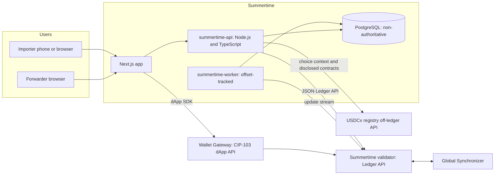
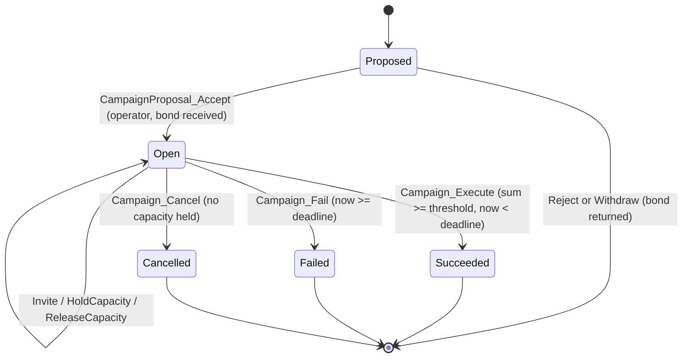
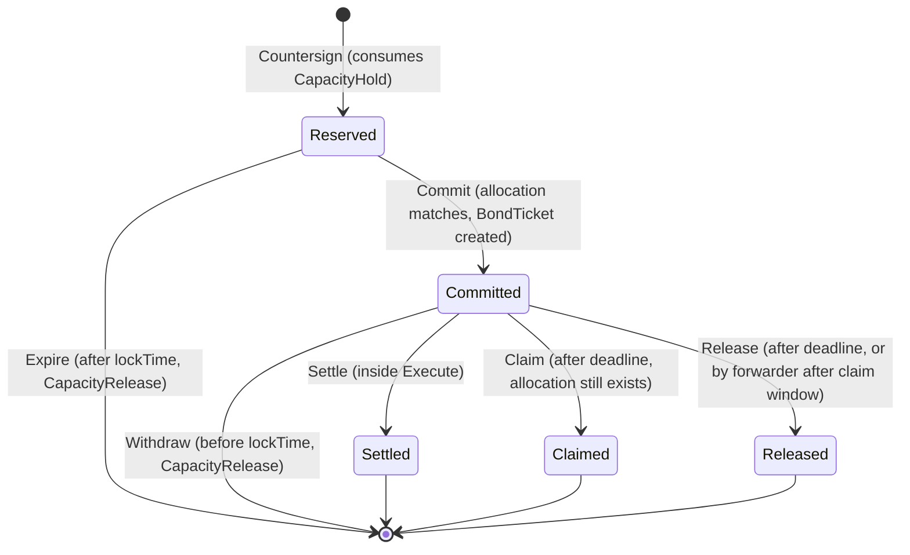
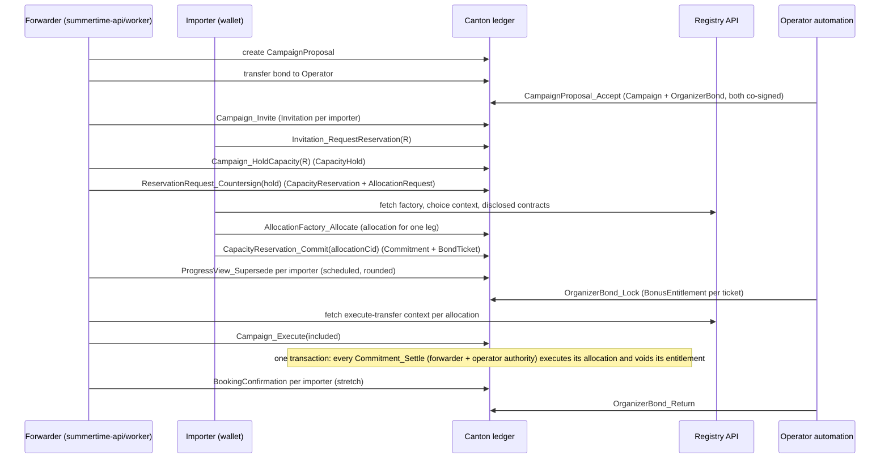
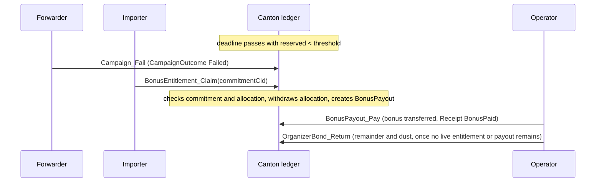
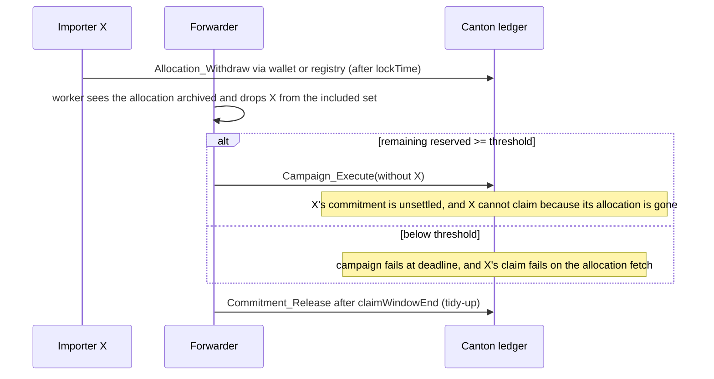
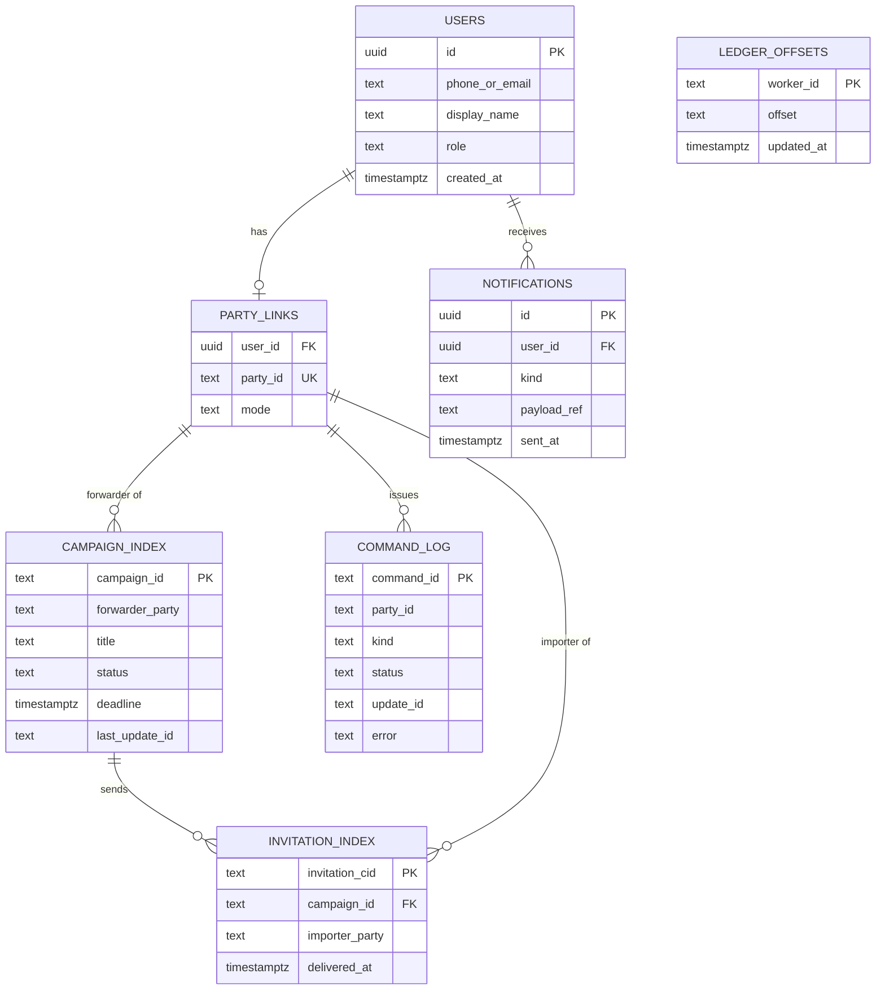
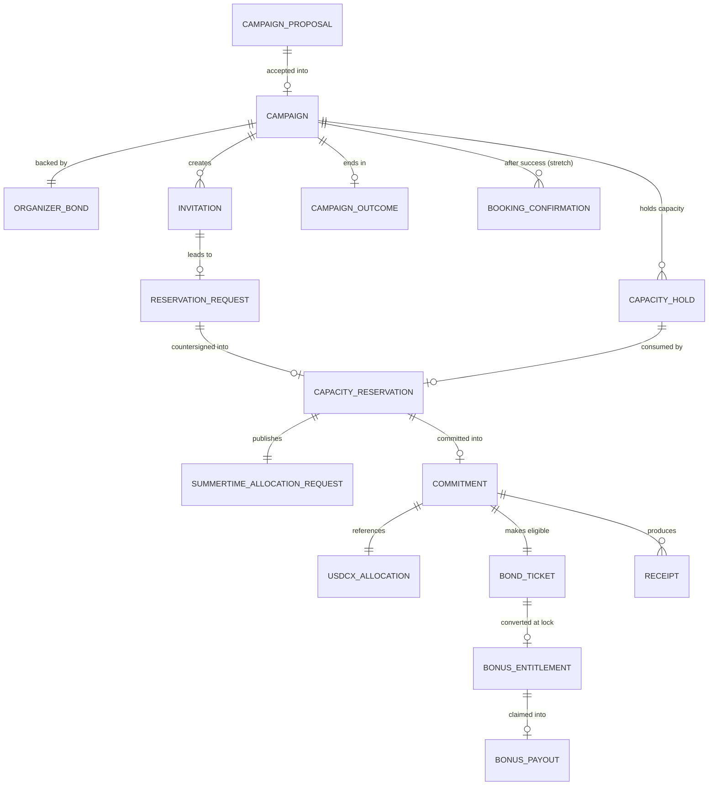

# Summertime — Build Specification

**Commit together. Settle together.**

Version 1.2 · 16 November 2026 · Produced from the Carde Master Prompt v2 (ChatGPT's master prompt plus three mandatory design decisions). The product was renamed from Carde to Summertime in version 1.1. Version 1.2 records the implementation status and the changes made while building it.

**How to read this document.** Every statement is labelled where it matters:

- **Verified** — confirmed in official documentation or source code, with a link.
- **Proposed** — an engineering decision made in this specification.
- **Dependency** — needs an external party, network access or provider.
- **Research** — unresolved; must be answered before the dependent feature ships.

Requirement keywords MUST, SHOULD and MAY are used in their normal specification sense.

---

## Implementation Status (Version 1.2)

The MVP described here is implemented in this repository and runs end to end on a local Canton sandbox (Canton 3.7.1, Daml SDK 3.7.1) with Splice's reference CIP-56 token standing in for USDCx. It has not yet been deployed to DevNet.

| Area | Status | Evidence |
| --- | --- | --- |
| Contracts (section 13), including bookings and disputes | Implemented | `daml/summertime-core`; 21 Daml Script tests |
| API (section 20) | Implemented | `services/api`; reference in `docs/api.md` |
| Worker automation (section 19.4) and pilot custody | Implemented | `services/worker` |
| Operations: reconciliation and monitoring (sections 19.3, 28) | Implemented | `services/worker/src/ops.ts`, `GET /ops/status` |
| Web app (sections 21, 23) | Implemented | `web` |
| CIP-56 registry integration | Implemented against the standard off-ledger API; tested against a local registry for the reference token | `packages/ledger/src/registry.ts`, `services/dev-registry` |
| Privacy tests on separate participants (26.2) | Implemented: a campaign runs across three participants (Summertime, importer A, importer B) on one synchronizer; no transaction delivered to an importer's participant mentions another importer, and the single settlement transaction reaches each importer as its own leg only | `tests/multi-participant` (`run.sh`), `Summertime.Test.MultiParticipant`; CI job `multi-participant` |
| Accounts (sections 22, 25) | Implemented: sign-in by email code through Privy (hosted); email and password (scrypt) with rate limits and emailed reset as the fallback; demo accounts kept separate | `services/api/src/routes/auth.ts`, `services/api/src/privy.ts`; guard and Privy tests |
| Hosted deployment | Implemented at https://summertime-app.netlify.app: web on Netlify; API, worker, registry and a persistent single-node Canton ledger (Postgres storage) on Railway. Accounts and campaigns survive redeploys and crashes | `deploy/backend`, `docs/deployment.md` |
| Notifications (sections 19.4, 22, 28) | Implemented: the worker records events from each account's own ledger view (invitations, space held, funds locked, ready to settle, 24-hour reminder, settled, refunded, bonus paid, bookings, disputes, outcomes); in-app inbox with unread count; branded email to members who keep it on | `services/worker/src/notify.ts`, `web/components/notifications.tsx`; `tests/e2e/features.e2e.ts` |
| Auto-settle (section 19.4, "MAY auto-execute") | Implemented: opt-in per campaign, at creation or later; the worker settles as soon as the threshold is met, before the deadline | `services/worker/src/forwarder.ts` (`autoSettlePass`); features test |
| Contact page (section 23.1) | Implemented: `/contact`, messages stored and shown to the operator on Operations, optional copy by email | `services/api/src/routes/account.ts`, `web/app/contact` |
| Account deletion ("contact data is deleted on request") | Implemented, self-service: personal data and sign-in removed, ledger history kept; refused while obligations are open | `POST /auth/account/delete`; features test |
| DevNet deployment, real USDCx | Not yet | — |
| Wallet mode | Not yet (pilot mode only) | — |

End-to-end suites, all passing against the live stack: success and failure campaigns through the API; authorization, idempotency and visibility guards; bond custody reconciliation under simulated operator misuse; the full browser journey on phone-sized screens through booking and dispute resolution; and a WCAG 2.1 A/AA audit of every page.

### Changes made during implementation

| Item | Specification said | Implemented | Why |
| --- | --- | --- | --- |
| Booking and dispute creation | Separate forwarder- and importer-created contracts | Choices on the `Settled` receipt: `Receipt_ConfirmBooking`, `Receipt_OpenDispute` | A booking or dispute always refers to a real settlement |
| `BookingConfirmation_Acknowledge` | Non-consuming | Consuming; recreates the booking with `acknowledgedAt`; `BookingConfirmation_Amend` clears it | A non-consuming choice leaves no trace in the active contract set |
| Dispute resolution | `DisputeRecord_Resolve` (consuming) | Creates a `DisputeResolution` signed by both importer and forwarder | Both sides hold the outcome |
| Dispute evidence | `evidenceHash` field | Evidence text stays in the application database, readable only by the two parties; the ledger holds its SHA-256 hash and the API verifies it | No documents on the ledger; integrity remains provable |
| `BonusEntitlement`, `BonusPayout` | No reservation size | Carry `reservedMilliCbm` into the `BonusPaid` receipt | The receipt records which reservation the bonus was for |
| Capacity holds | On-ledger only | The worker also records request→hold in Postgres | A crash between hold and countersign reuses the hold instead of holding twice |
| Custody alert response | "Pause new campaigns" (section 28) | Enforced: operator automation holds new proposals while the custody check is in alert | Makes the runbook automatic |
| Bonus split arithmetic | Formula on locked amounts | Computed on reserved milli-CBM (identical result, since every importer shares one rate) | Avoids integer overflow on large campaigns |

### Finding on open question 1

Splice's reference token keeps an allocation fetchable and withdrawable after its `settleBefore`; only execution checks the deadline. The claim check therefore works as designed with that token. Whether the USDCx Registry Utility behaves the same is still open and must be checked on DevNet before choosing between the primary design and the section 18.4 fallback.

---

## Changes in Version 1.1

Version 1.0 was reviewed against the Daml authorization and privacy model. As written, the forwarder could take an importer's funds without the container filling and could avoid paying the failure bonus, and several contracts leaked competitors' identities or volumes. Version 1.1 fixes these problems and updates every affected section.

| # | Problem in v1.0 | Fix in v1.1 | Sections |
| --- | --- | --- | --- |
| 1 | `Commitment_Settle` was controlled by the forwarder alone, so the forwarder could call it directly and skip the threshold check. `Campaign` was forwarder-only, so the forwarder could also create a second campaign with a lower threshold. | `Campaign` is co-signed by forwarder and operator through a proposal the operator validates. `Commitment_Settle` has forwarder and operator as joint controllers. The operator's authority exists only inside a choice on a co-signed `Campaign`, and that code checks threshold and deadline. | 1, 7, 10, 13, 18 |
| 2 | The bonus depended on the forwarder: it chose the eligible list at lock, could skip the lock entirely, and could void any bonus with `Commitment_MarkDefaulted`. | Each importer's own commit creates its eligibility (`BondTicket`). The operator, not the forwarder, runs the lock. `Commitment_MarkDefaulted` is removed: a claim instead proves the importer's allocation still exists. A committed importer left out of a successful settlement can also claim. | 7, 13, 17, 18 |
| 3 | The spec said the bond could move only through Summertime's choices. In fact the operator owns the bond holdings outright and can move them through the token's transfer factory. | Bond custody is stated as trust in the operator, with daily reconciliation and a Phase 2 neutral escrow. | 10.4, 17.3, 25 |
| 4 | `CapacityReservation_Commit` did not check `allocateBefore` or `settleBefore`. An importer could commit an allocation that expires early, make settlement fail and collect a bonus. | Commit checks every field of `SettlementInfo` and the transfer leg. | 7, 13.4, 15.2 |
| 5 | `CampaignProgress` listed every invited importer as an observer, exposing their identities to each other. | One `ProgressView` per importer. | 7, 10, 13 |
| 6 | `ReservationRequest_Countersign(runningTotal)` showed each importer the running total of everyone else's reservations. Capacity was enforced only by that forwarder-supplied number. | Capacity is held on the co-signed `Campaign` in a separate transaction (`Campaign_HoldCapacity`). Countersign consumes a `CapacityHold` that carries only the importer's own size. | 7, 13 |
| 7 | Progress updated after every change, so the difference between two readings revealed each new reservation's exact size. | Progress is rounded down to whole CBM and published on a fixed schedule. | 7, 10.3 |
| 8 | The bonus amount let each importer compute the total locked by all eligible importers, even with only two participants. | The proportional split applies only when at least three importers are eligible; otherwise the split is equal. The remaining leak is disclosed. | 10.3, 17.2 |
| 9 | The operator was said to see no reservations, but it received every importer's amount at lock. In pilot mode Summertime hosts every party and sees everything. | The operator is a disclosed observer of all reservations, and the privacy promise names it. Pilot-mode custody is disclosed. | 1, 10, 21, 23 |
| 10 | `OrganizerBond` needed the forwarder's signature but was created by the operator alone. `committedCount` was never updated. `Campaign_Fail`'s precondition contradicted section 10.4. | Campaign and bond are created together when the operator accepts the forwarder's proposal. `committedCount` is replaced by the on-ledger `heldMilliCbm`. The cancellation rules are consistent. | 7, 13, 14 |
| 11 | Bonus claims would have the importer spend operator-owned holdings it cannot see, with every claim contending for the same holdings. | A claim records a `BonusPayout`, and operator automation pays it, so one submitter serializes all payouts. | 13, 17, 18 |
| 12 | MVP scope was too large for 20 days. | On-ledger booking confirmations and disputes, wallet mode and the market-launch demo are stretch goals. | 6, 33, 35, 37 |

**Change to Decision 3 (privacy promise).** Fix 1 needs a second signer, and the only other party in the design is the operator. A signatory is an informee of every exercise on its contract, so the operator now sees every settlement leg. The v1.0 promise would therefore be inaccurate. The promise becomes:

> *"Competing importers cannot see each other's reservations, volumes or identities. Your forwarder sees your reservation, exactly as it does today, and so does Summertime, which enforces the settlement rules. Funds move only if the container fills."*

**Decision 1 still holds.** The forwarder remains the settlement coordinator: it decides when to settle and which committed importers to include. The operator does not coordinate. Its automation co-signs campaigns with valid terms, holds the bond, locks it and pays bonuses.

---

## 1. Executive Summary

Summertime lets competing importers reserve space in a shared shipping container without seeing each other's volumes or identities. Each importer locks USDCx against a forwarder-signed capacity reservation. When the reserved capacity reaches the container threshold before the deadline, every importer's payment settles to the forwarder in **one atomic Canton transaction**. If the threshold is not reached, every importer's funds become available again and each eligible importer claims a share of a failure bonus the forwarder posted upfront.

**First market:** freight forwarders and the importers who share their consolidated (groupage) containers on the China–Lagos route.

**Category:** private multi-party commitment and settlement infrastructure on Canton. Summertime is not crowdfunding, a payment app, an escrow wallet or a trading venue.

**The three mandatory decisions (from the v2 prompt), applied everywhere:**

1. **The forwarder is the settlement coordinator.** There is no separate coordinator party in the MVP.
2. **Commitments are forwarder-signed CBM reservations.** The threshold is in milli-CBM. Locked amount = reserved milli-CBM × the forwarder's signed rate, in integers.
3. **No coordinator-confidentiality claim.** The privacy promise is exactly: *"Competing importers cannot see each other's reservations, volumes or identities. Your forwarder sees your reservation, exactly as it does today, and so does Summertime, which enforces the settlement rules. Funds move only if the container fills."* (Wording amended in v1.1 to name the operator; see Changes in Version 1.1.)

**Five findings from source-code research that shape the design** (each detailed later):

1. **Importers MUST NOT be stakeholders of the campaign contract.** Under the Daml ledger model, an informee of an action sees that action including all its consequences ([Digital Asset, ledger privacy 3.5](https://docs.digitalasset.com/overview/3.5/explanations/ledger-model/ledger-privacy.html)). An importer observing the campaign would see every other importer's settlement leg. Terms reach each importer through a private per-importer invitation instead.
2. **A token allocation cannot be locked against its owner.** In the CIP-56 allocation interface, `Allocation_Withdraw` is controlled by the sender alone ([Splice AllocationV1.daml](https://github.com/hyperledger-labs/splice/blob/main/token-standard/splice-api-token-allocation-v1/daml/Splice/Api/Token/AllocationV1.daml)). Summertime's "lock" is economic: a late withdrawal forfeits the bonus, and settlement proceeds without that importer if the rest still meet the threshold.
3. **Settlement needs three authorities, and a guard.** `Allocation_ExecuteTransfer` is controlled jointly by executor, sender and receiver (same source). Each importer's commitment is co-signed by the importer and the forwarder, so settling it carries the importer's authority for that one allocation. A party can exercise any choice it controls directly, so settlement also requires the operator's authority. That authority exists only inside the co-signed `Campaign`, whose code checks the threshold and deadline.
4. **An enforceable failure bonus needs a custodian, and eligibility must not depend on the forwarder.** Anything left in the forwarder's own allocation can be withdrawn by the forwarder, so the bond is transferred to the Summertime operator. The operator then owns those holdings, so bond custody is trust in the operator, disclosed to every user. Each importer's eligibility is created by its own commit, and the operator runs the lock. A bonus disappears only when that importer's own funds settle or the importer withdraws.
5. **Stakeholder lists and choice arguments are visible.** Every stakeholder sees a contract's full signatory and observer lists, and every informee of an exercise sees its choice arguments. A shared contract with many importer observers leaks identities, and a choice argument carrying a running total leaks volumes. The design uses neither.

**What success looks like for the hackathon:** a six-importer campaign settles in one transaction on DevNet with a real update ID; a failed campaign pays every eligible importer its bonus; privacy is demonstrated from each party's own ledger view; at least one real forwarder has used the product.

---

## 2. Product Identity and Positioning

| Item | Value |
| --- | --- |
| Product name | Summertime |
| Tagline | Commit together. Settle together. |
| Category | Private multi-party commitment and settlement infrastructure |
| Former working names | Quorum (collides with the well-known GoQuorum enterprise Ethereum client); Carde (version 1.0 of this specification) |
| Ecosystem | Canton Network |
| First market | Consolidated container shipping, China–Lagos |
| Settlement asset | USDCx (CIP-56 token); Canton Coin as the development and fallback asset |

**Positioning statement.** For freight forwarders who fill shared containers, Summertime is a commitment and settlement system that collects binding, private capacity reservations from competing importers and settles them all at once only when the container is full. Unlike upfront payment to a consolidator, no importer's money moves unless everyone needed is in, and no importer can see another's volume.

**Comparison with adjacent categories.**

| Category | Why Summertime is different |
| --- | --- |
| Crowdfunding | Commitments are bound to physical capacity, private between competitors, and settled atomically on-ledger. |
| Escrow | No pooled escrow of participant funds. Each importer's funds stay in its own allocation until all-or-nothing settlement. |
| Group purchasing | Participants never see each other; the threshold is enforced by Daml, not by an organiser's promise. |
| Payments | Summertime moves money only when a multi-party condition is met. |
| Prediction markets / trading | No price discovery, no speculation, no order book. |

**Unique value proposition.** Competitors can coordinate a shared purchase without trusting each other or revealing anything to each other, and nobody pays unless the purchase actually happens.

---

## 3. Product Vision

Summertime becomes the commitment layer for purchases that only happen if enough parties join: filling a container, launching a market with enough liquidity, funding shared infrastructure, buying in bulk. The long-term product is a reusable Daml commitment engine with an API that other Canton applications embed.

**Why now.** Canton offers three properties together that commitment mechanisms need: sub-transaction privacy, atomic multi-party settlement and a standard token interface with an allocation workflow (CIP-56). USDCx gives that workflow a dollar asset that businesses understand ([Circle xReserve chains](https://developers.circle.com/xreserve/references/supported-blockchains-and-domains)).

**Design inspiration, stated honestly.** Summertime is a commitment mechanism inspired by Alex Tabarrok's dominant assurance contract, in which an entrepreneur profits when the quorum is reached and pays signers extra if it is not ([Wikipedia: Assurance contract](https://en.wikipedia.org/wiki/Assurance_contract)). Laboratory work studies refund-bonus designs ([Cason, Tabarrok and Zubrickas](https://www.awi.uni-heidelberg.de/md/awi/forschung/tcason_abstract.pdf)). Those results rest on model assumptions; Summertime makes **no** dominant-strategy claim about real campaigns.

---

## 4. Problem Statement

Small importers cannot fill a container alone, so they share one. In groupage, importers share container space to cut per-unit freight costs ([Wigmore Trading](https://wigmoretrading.com/?p=31976)). The route has a record of abuse: consolidators have been accused of exploiting importers with arbitrary charges ([Shipping Position](https://shippingposition.com.ng/cargo-consolidators-exploiting-nigerians-with-arbitrary-charges-farinto)), and a shippers' association head has said groupage problems come mainly from Chinese shipping agencies handling groupage containers ([ThisDay](https://www.thisdaylive.com/2021/08/27/nigerias-ravenous-ports/)). The same article notes most successful big importers in Nigeria started with groupage.

**The coordination failures Summertime addresses:**

| Failure | Today | With Summertime |
| --- | --- | --- |
| Pay-first risk | Importers pay before the container is confirmed full | Funds stay in each importer's allocation until the container fills |
| First-mover reluctance | Nobody wants to commit first | Committing is protected: either the container fills or the importer is refunded plus a bonus |
| Competitive leakage | Importers in the same market learn each other's volumes through the consolidator's group chats | Each reservation is visible only to its importer, the forwarder and the Summertime operator |
| Partial execution | Some pay, some don't; the container ships late or not at all | All reservations settle together or none do |

**What Summertime does not solve (stated to judges):** a forwarder who takes payment and then fails to ship. Summertime records booking confirmations and disputes on-ledger, but physical delivery stays off-ledger and contractual.

---

## 5. Target Customers and Market

| Role | Who | What they want |
| --- | --- | --- |
| **Buyer (pays Summertime)** | Independent freight forwarders and consolidators running groupage containers on China–Lagos routes | Faster container fills, credible commitments, fewer payment disputes |
| **End user** | SME importers buying roughly 1–15 CBM per shipment | Safety for their money, confidentiality of their volumes, a fair rate |
| **Economic decision-maker** | Forwarder owner or operations manager | Revenue per container, working capital, reputation |
| **Existing alternative** | Upfront transfer to the consolidator, coordinated over WhatsApp | (status quo) |

**Ideal customer profile (hypothesis to validate):** a forwarder running at least two groupage containers a month with an existing importer base it already knows by name.

**Market sizing:** not estimated in this document. No sourced figure for Lagos groupage volume was found; the first customer interviews (section 29) must collect containers per month and CBM per importer, and sizing follows from those numbers.

---

## 6. Core Use Cases

| # | Use case | Scope |
| --- | --- | --- |
| UC-1 | **Shared container campaign.** A forwarder opens a 60 CBM campaign; importers reserve privately; it settles atomically when full. | MVP |
| UC-2 | **Failed campaign with bonus.** The deadline passes below threshold; allocations are released; eligible importers claim bonuses. | MVP |
| UC-3 | **Withdrawal before lock.** An importer changes its mind before the lock time and leaves without penalty. | MVP |
| UC-4 | **Late withdrawal.** An importer pulls its allocation after lock; settlement proceeds without it if the rest meet the threshold; the importer forfeits its bonus. | MVP |
| UC-5 | **Booking confirmation and dispute.** After success, the forwarder issues a booking confirmation; an importer can open a dispute. | Stretch (off-ledger under the forwarder agreement in the MVP) |
| UC-6 | **Canton market launch.** The same engine collects conditional liquidity commitments for a new Canton market. | Stretch: demo only (20 seconds) |
| UC-7 | **Group purchasing, consortium funding, liquidity bootstrapping.** | Post-MVP |


---

## 7. Functional Requirements

Each feature below lists purpose, technical design, dependencies, business rules, authorization, failure behaviour, acceptance criteria and tests. Template and choice names refer to section 13.

### F-1 Campaign creation and bond escrow

- **Purpose:** let a forwarder publish immutable campaign terms backed by a failure bond. The operator co-signs the campaign so that its terms and settlement rules bind the forwarder.
- **Design:** the forwarder creates `CampaignProposal` (signatory forwarder, observer operator) with `CampaignTerms`, and transfers `bondMicroUsdc` to the operator party with the campaign ID in the transfer metadata. Operator automation validates the terms, checks that the campaign ID is unused and confirms the bond holdings arrived. It then exercises `CampaignProposal_Accept(bondHoldingCids)`, which creates `Campaign` and `OrganizerBond` (both signed by forwarder and operator) in one transaction. The campaign is open from creation.
- **Dependencies:** USDCx (or Canton Coin) holdings for the forwarder; operator automation; registry transfer flow.
- **Business rules:** MUST reject terms where `thresholdMilliCbm > containerCapacityMilliCbm`, `minReservation > maxReservation`, `lockTime >= deadline`, `deadline >= claimWindowEnd`, or the bond is outside 1–5% of full-capacity value (Proposed defaults). These are `ensure` clauses on `Campaign`, and operator automation checks them before accepting. Campaign IDs MUST be unique per operator. Daml 3 has no contract keys, so the operator enforces uniqueness; it co-signs every campaign and therefore sees them all. Terms MUST NOT change after acceptance.
- **Authorization:** only the forwarder proposes; only operator automation accepts or rejects. The forwarder alone cannot create `Campaign` or `OrganizerBond`.
- **Failure behaviour:** if the bond does not arrive or the terms are invalid, the operator exercises `CampaignProposal_Reject` and returns any bond holdings received. The forwarder MAY withdraw the proposal with `CampaignProposal_Withdraw`, after which the operator returns the bond.
- **Acceptance:** no `Campaign` exists without a matching `OrganizerBond` and the operator's signature.
- **Tests:** invalid terms rejected; forwarder alone cannot create `Campaign` or `OrganizerBond`; duplicate campaign ID rejected by operator automation; bond below minimum rejected; terms unchanged after acceptance.

### F-2 Private invitations

- **Purpose:** deliver campaign terms to each importer without revealing other invitees.
- **Design:** `Campaign_Invite` (non-consuming, forwarder) creates one `Invitation` per importer, signatory forwarder, observer that importer, carrying a copy of the terms. The worker sends the importer an SMS or email link. The operator, as a signatory of `Campaign`, sees the invitations (disclosed, section 10.4).
- **Business rules:** invitations expire at `lockTime`. The forwarder MAY revoke an invitation that has no reservation. An importer that withdraws before lock needs a new invitation to reserve again.
- **Authorization:** only the forwarder invites; only the named importer sees and acts on its invitation.
- **Failure behaviour:** an undelivered message does not affect ledger state; the forwarder can resend.
- **Acceptance:** importer B cannot fetch importer A's invitation.
- **Tests:** privacy query as B returns nothing; expired invitation cannot be used.

### F-3 Capacity reservation (Decision 2)

- **Purpose:** turn an importer's request for space into a forwarder-countersigned, fixed-price capacity reservation, without overbooking the container and without showing the importer anyone else's reservations.
- **Design:** the importer exercises `Invitation_RequestReservation(reservedMilliCbm)`, creating `ReservationRequest`. Forwarder automation then runs two separate transactions:
  1. `Campaign_HoldCapacity(reservedMilliCbm)` on the co-signed `Campaign` checks `heldMilliCbm + reservedMilliCbm ≤ containerCapacityMilliCbm`, increases `heldMilliCbm` and creates a `CapacityHold` (signatories forwarder and operator) for that size. The importer is not an informee of this transaction.
  2. `ReservationRequest_Countersign(holdCid)` consumes the hold and checks that its campaign and size match the request. It computes `lockedMicroUsdc = reservedMilliCbm × rateMicroUsdcPerMilliCbm` and creates `CapacityReservation` (signatories forwarder and importer) plus a `SummertimeAllocationRequest` for the importer's wallet. The importer sees the hold, which carries only its own size; it never sees `heldMilliCbm`.
- **Business rules:**
  - `minReservationMilliCbm ≤ reservedMilliCbm ≤ maxReservationMilliCbm`.
  - Total held capacity MUST NOT exceed container capacity, and `Campaign_HoldCapacity` enforces this on-ledger. Over-capacity requests are rejected rather than cut pro rata, because cutting would change a signed financial commitment; waitlisting is handled off-ledger.
  - Capacity returns to the campaign only through an unused `CapacityHold` or a `CapacityRelease`. The importer co-signs every `CapacityRelease`; one is created when a reservation expires or a commitment is withdrawn. The forwarder therefore cannot free an active reservation's capacity to overbook.
  - One reservation per invitation: the request consumes the invitation.
- **Authorization:** importer requests; forwarder holds capacity and countersigns or rejects.
- **Failure behaviour:** over-capacity or out-of-bounds requests are rejected with a reason; nothing is locked. An unused hold is released with `Campaign_ReleaseCapacity`.
- **Acceptance:** locked amount always equals reserved milli-CBM × rate; total held never exceeds capacity.
- **Tests:** boundary sizes; overflow rejected by `Campaign_HoldCapacity`; hold for a different size or campaign rejected; forwarder alone cannot create a `CapacityHold` or `CapacityRelease`; importer's countersign transaction tree contains no total; amount arithmetic.

### F-4 Allocation and commitment

- **Purpose:** bind the importer's real USDCx to its reservation and make the importer eligible for the failure bonus.
- **Design:** the importer's wallet signs `AllocationFactory_Allocate` for the leg described by the `SummertimeAllocationRequest`, with choice context and disclosed contracts from the registry's off-ledger API. The importer then exercises `CapacityReservation_Commit(allocationCid)`. This fetches the allocation by interface and asserts that its settlement info and transfer leg equal the reservation's in every field (section 13.4). It then creates `Commitment` (signatories importer and forwarder) and a `BondTicket` (signatories importer and forwarder, observer operator) recording the importer's bonus eligibility.
- **Dependencies:** registry off-ledger API; wallet support for disclosed contracts; Utility DAR bundle on the participant.
- **Business rules:** MUST happen before `lockTime`. Executor, settlement reference, `requestedAt`, `allocateBefore` (= `lockTime`), `settleBefore` (= `deadline`), leg ID, sender, receiver, instrument and amount MUST match. If `settleBefore` were not checked, an importer could commit an allocation that expires before the deadline: settlement would then fail and the importer would collect a bonus.
- **Authorization:** only the importer allocates and commits.
- **Failure behaviour:** any mismatch fails the commit; the reservation expires at `lockTime` if never committed.
- **Acceptance:** no `Commitment` exists without a matching allocation, and every `Commitment` has a `BondTicket` until lock.
- **Tests:** each mismatched field rejected, including an allocation whose `settleBefore` is earlier than the deadline; commit after lock rejected; double commit rejected.

### F-5 Withdrawal before lock

- **Purpose:** let importers leave freely before the lock time.
- **Design:** `Commitment_Withdraw` (importer, before `lockTime`) exercises `Allocation_Withdraw`, archives the commitment and its `BondTicket`, and creates a `CapacityRelease` so that the forwarder can return the capacity to the campaign.
- **Authorization:** importer only.
- **Failure behaviour:** after `lockTime` the choice fails. The importer can still withdraw directly through the registry (section 15.3), with the consequences of UC-4.
- **Acceptance and tests:** withdrawal before lock leaves no commitment, no ticket and no penalty; after lock the Summertime choice is rejected.

### F-6 Aggregate progress

- **Purpose:** show importers how close the container is without revealing anyone.
- **Design:** forwarder automation publishes progress on a fixed schedule (Proposed: hourly, and once at `lockTime`), not after each change. For each invited importer it exercises `ProgressView_Supersede` on that importer's own `ProgressView` (signatory forwarder, observer that importer only). The view carries `reservedCbmRounded` (committed capacity rounded down to whole CBM), optional `participantCount`, `hidden` and `asOf`. Progress updates are always separate transactions from commitment changes.
- **Business rules:**
  - Progress MUST be hidden while fewer than three importers have committed.
  - Rounding and the fixed schedule stop importers reading a competitor's exact size from the difference between two readings. When only one commitment changed between two readings, the difference still shows that commitment's size to the nearest CBM, but not who made it. This leak is disclosed.
  - The forwarder MAY hide the participant count.
- **Acceptance and tests:** each `ProgressView` has exactly one importer observer; the importer view shows only aggregates; hidden below three participants; no progress transaction touches a commitment.

### F-7 Lock and bonus entitlements

- **Purpose:** freeze the eligible set and create enforceable bonus claims without depending on the forwarder.
- **Design:** at `lockTime`, operator automation exercises `OrganizerBond_Lock(ticketCids)` with every live `BondTicket` for the campaign. It computes each bonus (section 17.2) and exercises `BondTicket_Convert` on each ticket, which archives the ticket and creates one `BonusEntitlement` (signatories operator and forwarder, observer that importer).
- **Business rules:**
  - The sum of entitlements plus dust MUST equal the bond.
  - Per-importer cap of 3× an equal split (Proposed); equal split when fewer than three importers are eligible.
  - The lock MUST include every live ticket. Each importer's own commit creates its ticket, so the forwarder cannot leave anyone out. Completeness rests on operator automation, which sees every ticket; Daml cannot prove it.
- **Authorization:** operator only. The forwarder takes no part.
- **Failure behaviour:** if operator automation is late, `Campaign_Execute` still works: settlement voids tickets directly. Claims require entitlements, so the operator MUST lock promptly (alert if not done within 10 minutes of `lockTime`).
- **Tests:** conservation; cap; equal split below three; entitlement visible only to its importer; forwarder cannot exercise `OrganizerBond_Lock`; ticket list with a duplicate or a foreign campaign rejected.

### F-8 Atomic settlement

- **Purpose:** move every included importer's funds to the forwarder in one transaction once the threshold is met.
- **Design:** the forwarder exercises `Campaign_Execute(included)`. For each included commitment it passes a `BonusRef` and the registry's execute-transfer `ExtraArgs`. The `BonusRef` is the importer's `BondTicket` before lock, or its `BonusEntitlement` after. Disclosed contracts are attached to the command. Daml re-sums reserved capacity, checks the threshold and deadline, then exercises `Commitment_Settle` for each commitment.
  - `Commitment_Settle` has two controllers, forwarder and operator. The operator's authority is available only because the operator co-signed `Campaign`, so the choice cannot be exercised outside `Campaign_Execute` (section 13.3).
  - It exercises `Allocation_ExecuteTransfer`, archives that importer's ticket or entitlement, and creates a `Receipt`.
  - A `CampaignOutcome(Succeeded)` is created.
- **Business rules:**
  - The sum of included `reservedMilliCbm` MUST be at least `thresholdMilliCbm`, and `now < deadline`.
  - Every included commitment MUST belong to the campaign, with no duplicates.
  - The forwarder chooses which committed importers to include. A committed importer left out keeps its bonus claim (F-9).
- **Authorization:** the forwarder submits; the operator's authority comes from `Campaign`. Neither the forwarder nor the operator can settle a commitment alone.
- **Failure behaviour:** any failing leg aborts the whole transaction; nothing moves. The backend retries with the same command-ID scheme until the deadline, re-reading the latest `Campaign` contract ID before each attempt.
- **Acceptance:** six legs settle under one update ID; each importer's transaction tree contains only its own leg.
- **Tests:** threshold boundary; deadline boundary; replay rejected; forwarder alone cannot exercise `Commitment_Settle`; privacy tree test.

### F-9 Failure, release and bonus claim

- **Purpose:** return control of funds, and pay bonuses to importers whose committed funds were not settled.
- **Design:** after the deadline, allocations are no longer executable; CIP-56 states holdings locked to an allocation become available to the owner immediately after the deadline ([CIP-56](https://github.com/canton-foundation/cips/blob/main/cip-0056/cip-0056.md)). Each importer with a `BonusEntitlement` exercises `BonusEntitlement_Claim(commitmentCid)`. The choice:
  1. checks the time window;
  2. fetches the importer's `Commitment`, proving it was neither settled nor withdrawn through Summertime;
  3. fetches the commitment's allocation, proving the importer did not withdraw it through the registry after lock;
  4. withdraws the allocation to release the importer's holdings and archives the commitment;
  5. creates a `BonusPayout` (signatories operator and forwarder, observer importer).

  Operator automation then exercises `BonusPayout_Pay`, transferring the bonus from the bond holdings and creating `Receipt(BonusPaid)`. The forwarder (or, as a fallback, the operator) SHOULD exercise `Campaign_Fail` after the deadline to record the outcome; claims do not depend on it.
- **Business rules:** the claim rule is the same whether the campaign failed or succeeded without that importer: a committed, eligible importer whose funds were not settled is paid. An importer that withdrew its allocation through the registry after lock cannot claim, because the allocation fetch fails. Importers without an entitlement release their allocation with `Commitment_Release` after the deadline.
- **Authorization:** each importer claims only its own entitlement; only the operator pays.
- **Failure behaviour:** if an importer never claims, its entitlement stays live until `claimWindowEnd` (deadline + 90 days, Proposed). Then `BonusEntitlement_Expire` archives it and the remainder returns to the forwarder. If the registry archives expired allocations, the allocation check cannot work after the deadline; see section 18.4 and open question 1.
- **Tests:** claim before deadline rejected; double claim rejected; claim by another party rejected; claim after a registry withdrawal rejected; an importer excluded from a successful campaign can claim; conservation.

### F-10 Booking confirmation and disputes (stretch)

- **Scope:** stretch goal. If cut, booking references and disputes are handled off-ledger under the forwarder agreement.
- **Purpose:** connect on-ledger settlement to the physical booking.
- **Design:** after success, the forwarder issues `BookingConfirmation` per importer (booking reference, ETD, optional container number) within the agreed service time. An importer can create `DisputeRecord` (subject, evidence hash) at any time after settlement; the forwarder resolves it.
- **Business rules:** refunds after success are off-ledger under the forwarder agreement in the MVP (disclosed limitation).
- **Tests:** confirmation visible only to its importer; dispute visible only to importer and forwarder.

### F-11 Receipts and history

- **Purpose:** give every party a private, permanent record.
- **Design:** `Receipt` (signatory forwarder, observer importer) for Settled, Released, Withdrawn and BonusPaid, each carrying the relevant update ID. Receipts are convenience records signed by the forwarder; the authoritative evidence is the update ID, which the importer can look up in its own ledger view.
- **Tests:** each outcome produces exactly one receipt per affected importer.

### F-12 Privacy explorer (demo)

- **Purpose:** prove the privacy model to judges from real ledger data.
- **Design:** side-by-side panes, each populated from that party's own Ledger API view (not from a shared database).
- **Business rules:** disabled outside the demo environment.
- **Tests:** pane contents match the party's active contract set.

---

## 8. Non-Functional Requirements

| ID | Requirement | Verification |
| --- | --- | --- |
| NFR-1 | All Summertime amounts are integers (milli-CBM, micro-USDCx); conversion to the token's `Decimal` happens only when building transfer legs. Daml `Decimal` is fixed-point, not floating-point. | Unit tests on every conversion |
| NFR-2 | The ledger is the single source of truth for reservations, allocations, outcomes and receipts. | No code path reads financial state from PostgreSQL |
| NFR-3 | Every visibility claim has an automated test that fails if violated. | Privacy suite (section 26) |
| NFR-4 | Every command has a deterministic command ID; replays never double-submit. | Replay tests |
| NFR-5 | MVP supports 2–15 importers per campaign until settlement size is measured. | DevNet load test |
| NFR-6 | No user action is lost during ledger or worker downtime; the worker resumes from its stored offset. | Kill-and-resume test |
| NFR-7 | Importer flows work on a 360 px phone browser at WCAG AA contrast. | Manual and automated checks |
| NFR-8 | Settlement is submitted at least 24 hours before the deadline when the threshold is met (operational target). | Alerting |
| NFR-9 | Logs never contain another party's amounts outside that party's own scope. | Log review in CI |


---

## 9. Canton Network Architecture

**Parties (Proposed).**

| Party | Hosted on | Purpose |
| --- | --- | --- |
| Forwarder | Summertime validator (MVP) or the forwarder's own validator (later) | Organizer, coordinator, executor, receiver |
| Importer | Summertime validator in pilot mode; the importer's wallet provider in wallet mode | Reserves, allocates, claims |
| Operator | Summertime validator | Application operator; co-signer of every campaign (settlement guard); failure-bond custodian; runs the bond lock and bonus payouts |
| Auditor (optional) | Any validator | Read-only observer of `CampaignOutcome` |
| USDCx admin | Registry (external) | Instrument administrator under CIP-56 |

**Environments.**

| Stage | Purpose | Settlement asset |
| --- | --- | --- |
| Daml Sandbox (`dpm sandbox`) | Unit tests with Daml Script | Test token implementing the Splice allocation interfaces |
| LocalNet (cn-quickstart) | Multi-validator integration with Canton Coin wallet services | Canton Coin |
| DevNet | Hackathon demo | USDCx if DevNet access is available; Canton Coin otherwise |
| TestNet | Pilot rehearsal | USDCx (TestNet admin party published by Circle) |
| MainNet | Commercial pilot | USDCx |

**Verified tooling.** The Daml SDK is installed and managed with `dpm`; `dpm build` compiles, `dpm test` runs Daml Script tests, `dpm sandbox` starts a single-node sandbox, `dpm codegen-js` generates TypeScript bindings, and LocalNet comes from the cn-quickstart repository ([Canton SDKs and tools](https://docs.canton.network/sdks-tools/overview.md)). LocalNet runs three validators (super validator, app provider, app user) with wallet services, PostgreSQL and an NGINX gateway ([LocalNet guide](https://docs.canton.network/sdks-tools/development-tools/localnet.md)).

**Versions (Dependency).** The Version Compatibility Dashboard is the source of truth for Canton, Splice, Daml SDK, Wallet SDK and dApp SDK versions, and recommends DevNet versions for new projects ([dashboard](https://docs.canton.network/shared/version-compatibility-dashboard.md)). This specification deliberately pins no version numbers; read them from the dashboard on the day the repository is created.

**DevNet access (Dependency).** Joining DevNet requires a static egress IP and allowlisting, usually 2–7 days, or a node-as-a-service provider ([Canton Foundation builder guide](https://guide.canton.foundation/)).

---

## 10. Privacy and Authorization Architecture

### 10.1 The rule everything follows (Verified)

The Daml projection rule: if a party is an informee of an action, it keeps the action as-is **including its consequences**; otherwise it receives only the projection of the consequences ([Digital Asset, ledger privacy 3.5](https://docs.digitalasset.com/overview/3.5/explanations/ledger-model/ledger-privacy.html)). A contract observer is an informee of creates and consuming exercises on that contract, but not of non-consuming exercises or fetches ([Hacken privacy audit guide](https://hacken.io/discover/auditing-daml-privacy-on-canton-network/)). Signatories are informees of every exercise on their contract. Every stakeholder also sees the contract's full signatory and observer lists, and every informee of an exercise sees its choice arguments.

### 10.2 Privacy rules derived from it

- **P-1 (MUST):** importers are never signatories or observers of `Campaign`, `OrganizerBond` or `CampaignOutcome`. A consuming exercise on those contracts would otherwise expose every importer's leg to every importer.
- **P-2 (MUST):** each importer's settlement leg lives in its own `Commitment` (signatories importer and forwarder), exercised as a child of `Campaign_Execute`. Each importer then receives only its own subtree.
- **P-3 (MUST):** terms reach importers through per-importer `Invitation`s, never through observer rights on `Campaign`.
- **P-4 (MUST):** progress reaches each importer through its own `ProgressView`, with that importer as the only observer. Progress is rounded down to whole CBM, published on a fixed schedule and never updated inside a transaction that touches commitments.
- **P-5 (MUST):** no contract has more than one importer as a stakeholder. `Invitation`s, `BondTicket`s, `BonusEntitlement`s, `BonusPayout`s, `ProgressView`s and `Receipt`s each name exactly one importer.
- **P-6 (MUST):** a choice exercised in a transaction an importer can see MUST NOT carry other importers' data or running totals in its arguments. In particular, countersigning takes a `CapacityHold` carrying only the importer's own size, never a running total.
- **P-7 (disclosed):** the operator co-signs `Campaign`, so it sees every invitation and settlement leg, every `BondTicket` and every entitlement. It is not a stakeholder of requests, reservations or progress views, but this is not presented to users as a privacy property.

### 10.3 Visibility matrix (Proposed)

| Contract | Signatories | Observers | Importer A | Other importers | Forwarder | Operator |
| --- | --- | --- | --- | --- | --- | --- |
| `CampaignProposal` | Forwarder | Operator | No | No | Yes | Yes |
| `Campaign` | Forwarder, Operator | — | No | No | Yes | Yes |
| `CapacityHold` (for A) | Forwarder, Operator | — | Its archive in A's countersign (A's own size only) | No | Yes | Yes |
| `Invitation` (A) | Forwarder | Importer A | Yes | No | Yes | Yes (created inside `Campaign_Invite`) |
| `ReservationRequest` (A) | Importer A | Forwarder | Yes | No | Yes | No |
| `CapacityReservation` (A) | Forwarder, Importer A | — | Yes | No | Yes | No |
| `SummertimeAllocationRequest` (A) | Forwarder | Importer A | Yes | No | Yes | No |
| USDCx `Allocation` (A) | Registry-specific | Registry-specific | Yes (sender) | No | Yes (executor, receiver) | Its settlement or claim |
| `Commitment` (A) | Importer A, Forwarder | — | Yes | No | Yes | Its settlement or claim |
| `BondTicket` (A) | Importer A, Forwarder | Operator | Yes | No | Yes | Yes |
| `CapacityRelease` (A) | Importer A, Forwarder | — | Yes | No | Yes | When consumed by `Campaign_ReleaseCapacity` |
| `ProgressView` (A) | Forwarder | Importer A | Rounded aggregate only | No | Yes | No |
| `OrganizerBond` | Forwarder, Operator | — | No | No | Yes | Yes |
| `BonusEntitlement` (A) | Operator, Forwarder | Importer A | Yes | No | Yes | Yes |
| `BonusPayout` (A) | Operator, Forwarder | Importer A | Yes | No | Yes | Yes |
| `CampaignOutcome` | Forwarder, Operator | Auditor (optional) | No | No | Yes | Yes |
| `Receipt` (A) | Forwarder | Importer A | Yes | No | Yes | Settled and BonusPaid receipts |
| `BookingConfirmation` (A, stretch) | Forwarder | Importer A | Yes | No | Yes | No |
| `DisputeRecord` (A, stretch) | Importer A | Forwarder | Yes | No | Yes | No |

**What still leaks to importers, by design (disclosed):**

- `ProgressView` shows the committed capacity rounded down to whole CBM and, optionally, the participant count. It is hidden below three participants.
- When exactly one commitment changes between two scheduled readings, the difference reveals that commitment's size to the nearest CBM, but not who made it.
- A proportional bonus entitlement lets its importer compute the total locked by the eligible set at lock: it knows the bond and its own locked amount. The proportional split therefore applies only with three or more eligible importers (section 17.2).

The forwarder and the operator see everything.

### 10.4 Trust model (Decision 3)

| The forwarder CAN | The forwarder CANNOT |
| --- | --- |
| See every importer's reservation, amount and identity | Move an importer's funds without that importer's allocation |
| Choose when to settle once the threshold is met, and which committed importers to include | Settle any importer below the threshold or at/after the deadline. Settlement needs the operator's authority, which only the co-signed `Campaign` carries |
| Refuse to settle (the campaign then fails and bonuses become claimable) | Withhold refunds after failure (allocations stop being executable at the deadline) |
| Leave a committed importer out of a successful settlement (that importer can then claim its bonus) | Stop an importer that committed before `lockTime` from becoming bonus-eligible, or void its bonus without settling its funds |
| Cancel a campaign at no cost while no capacity is held | Change rate, threshold, capacity or deadline once the campaign exists, or reserve beyond container capacity |

The **operator** (Summertime) co-signs every campaign and the bond, so it sees every invitation, settlement leg, bond ticket and entitlement. Its automation accepts proposals with valid terms, runs the bond lock and pays bonuses. It cannot move importer funds: settlement also needs the forwarder (executor and receiver) and each importer's co-signed commitment. It cannot settle on its own, because `Campaign_Execute` is controlled by the forwarder.

**Bond custody is trust, not a ledger guarantee.** Once the forwarder transfers the bond, the operator owns those holdings. Summertime's contracts record what the operator owes, but the token standard lets the owner of a holding transfer it. Summertime discloses this to every user, reconciles bond holdings against live entitlements daily, and replaces operator custody with a neutral escrow in Phase 2. Bond custody is the only custodial element in Summertime.

**Pilot mode.** In pilot mode, Summertime's validator hosts the forwarder, the operator and the importers' parties, and holds their signing keys. Ledger privacy then protects importers from each other but not from Summertime, which operates the node and could act as any hosted party. Pilot mode is disclosed on every signing screen (section 21), and privacy tests run with separate participants (section 26.2). Forwarder and operator MUST use separate Ledger API users, because together they hold the authority that `Commitment_Settle` requires.

**Exact privacy promise (UI, pitch, brief):** *"Competing importers cannot see each other's reservations, volumes or identities. Your forwarder sees your reservation, exactly as it does today, and so does Summertime, which enforces the settlement rules. Funds move only if the container fills."*

---

## 11. System Architecture Diagram



| Component | Responsibility | Must not |
| --- | --- | --- |
| Next.js app | Forwarder, importer, explorer and public pages | Decide financial state; hold ledger credentials |
| summertime-api | Build and submit commands with command IDs; fetch registry choice context; enforce party-scoped authorization | Read financial truth from PostgreSQL |
| summertime-worker | Consume the update stream from a stored offset; project events; run forwarder and operator automation | Run more than one active instance per party |
| PostgreSQL | Profiles, party links, delivery and search indexes, command log | Store balances or outcomes as truth |
| Wallet Gateway + dApp SDK | Let importers sign with their own wallets; the dApp SDK (`@canton-network/dapp-sdk`) speaks the CIP-103 dApp API to a Wallet Gateway, which forwards signing to the configured provider ([wallet-gateway](https://github.com/canton-network/wallet-gateway)) | — |
| Registry off-ledger API | Serve choice context and registry-private contracts for allocation and transfer (CIP-56) | — |

---

## 12. Daml Package Architecture

| Package | Contents | Depends on |
| --- | --- | --- |
| `summertime-core` | All templates in section 13, `CampaignTerms`, validation and arithmetic helpers | Splice token-standard interface packages: holding, allocation, allocation-request, transfer-instruction, metadata |
| `summertime-test` | Daml Script suites; a test token implementing the allocation and transfer interfaces | `summertime-core` |

- `summertime-core` MUST depend only on token-standard **interfaces**, never on the USDCx implementation package, so the same code runs with Canton Coin or USDCx.
- Upgrades: new template versions are added side by side; live campaigns finish on the version they started on. Smart-contract-upgrade compatibility of the chosen SDK must be checked before the first DevNet deployment (Research).
- Daml 3.x does not support contract keys (confirm against the pinned SDK; open question 11). Uniqueness of campaign IDs is enforced by the operator, which co-signs every campaign; one reservation per invitation is enforced by consuming the invitation.
- Registry tokens need the Utility DAR bundle uploaded to the participant before related contracts can be created ([Noves](https://noves.fi/blog/canton-usdcx-tracking)). This is a deployment step, not a code dependency.

---

## 13. Complete Smart Contract Specification

All templates live in `summertime-core`. Field types use Daml names. "C" marks a consuming choice, "N" a non-consuming one. Every template also carries its parties (`forwarder`, `operator`, `importer` as applicable); they are omitted from the field lists for brevity.

### 13.1 Shared types

```
data CampaignTerms = CampaignTerms with
  containerCapacityMilliCbm : Int
  thresholdMilliCbm         : Int
  rateMicroUsdcPerMilliCbm  : Int
  minReservationMilliCbm    : Int
  maxReservationMilliCbm    : Int
  lockTime                  : Time
  deadline                  : Time
  instrumentId              : InstrumentId     -- { admin : Party, id : Text }
  tokenDecimals             : Int              -- read from registry metadata (Dependency)
  bondMicroUsdc             : Int
  claimWindowEnd            : Time             -- deadline + 90 days (Proposed)

data BonusRef = TicketRef (ContractId BondTicket)
              | EntitlementRef (ContractId BonusEntitlement)
data Outcome = Succeeded | Failed | Cancelled
data ReceiptKind = Settled | Released | Withdrawn | BonusPaid
```

There is no campaign or commitment status field. A `Campaign` that exists is open; a `Commitment` that exists is active. Settled, withdrawn, claimed and released commitments are archived, and a finished campaign is recorded in `CampaignOutcome`.

`toTokenDecimal : Int -> Int -> Decimal` converts micro-units to the token's precision. It MUST be exact for the registry's declared decimals and MUST reject values that cannot be represented.

### 13.2 Templates

| Template | Signatories | Observers | Fields | Choices |
| --- | --- | --- | --- | --- |
| `CampaignProposal` | forwarder | operator | `campaignId`, `terms` | `CampaignProposal_Accept(bondHoldingCids)` (C, operator) · `CampaignProposal_Reject(reason)` (C, operator) · `CampaignProposal_Withdraw` (C, forwarder) |
| `Campaign` | forwarder, operator | — | `campaignId`, `terms`, `heldMilliCbm : Int`, `bondCid : ContractId OrganizerBond` | `Campaign_Invite` (N, forwarder) · `Campaign_HoldCapacity` (C, forwarder) · `Campaign_ReleaseCapacity` (C, forwarder) · `Campaign_Execute` (C, forwarder) · `Campaign_Fail` (C, forwarder or operator) · `Campaign_Cancel` (C, forwarder) |
| `CapacityHold` | forwarder, operator | — | `campaignId`, `reservedMilliCbm` | `CapacityHold_Consume` (C, forwarder) |
| `Invitation` | forwarder | importer | `campaignId`, `operator`, `terms`, `expiresAt` (= `lockTime`) | `Invitation_RequestReservation` (C, importer) · `Invitation_Decline` (C, importer) · `Invitation_Revoke` (C, forwarder) |
| `ReservationRequest` | importer | forwarder | `campaignId`, `operator`, `terms`, `reservedMilliCbm` | `ReservationRequest_Countersign(holdCid)` (C, forwarder) · `ReservationRequest_Reject(reason)` (C, forwarder) |
| `CapacityReservation` | forwarder, importer | — | `campaignId`, `operator`, `reservationId`, `reservedMilliCbm`, `lockedMicroUsdc`, `transferLegId`, `requestedAt`, `terms` | `CapacityReservation_Commit(allocationCid)` (C, importer) · `CapacityReservation_Expire` (C, either, at or after `lockTime`) |
| `SummertimeAllocationRequest` (implements `AllocationRequest`) | forwarder | importer | `settlement : SettlementInfo`, `transferLegs : TextMap TransferLeg` (one leg) | interface `AllocationRequest_Reject`, `AllocationRequest_Withdraw` |
| `Commitment` | importer, forwarder | — | `campaignId`, `operator`, `reservationId`, `reservedMilliCbm`, `lockedMicroUsdc`, `allocationCid : ContractId Allocation`, `terms` | `Commitment_Withdraw` (C, importer, before `lockTime`) · `Commitment_Settle` (C, **forwarder and operator jointly**) · `Commitment_Close` (C, importer; used by `BonusEntitlement_Claim`) · `Commitment_Release(cancelAllocation)` (C, importer at or after `deadline`; forwarder at or after `claimWindowEnd`) |
| `BondTicket` | importer, forwarder | operator | `campaignId`, `reservationId`, `lockedMicroUsdc` | `BondTicket_Convert(bonusMicroUsdc)` (C, operator) · `BondTicket_Void` (C, importer; used by `Commitment_Withdraw` and `Commitment_Settle`) |
| `CapacityRelease` | importer, forwarder | — | `campaignId`, `reservedMilliCbm` | `CapacityRelease_Consume` (C, forwarder) |
| `ProgressView` | forwarder | one importer | `campaignId`, `reservedCbmRounded : Int`, `participantCount : Optional Int`, `hidden : Bool`, `asOf` | `ProgressView_Supersede` (C, forwarder) |
| `OrganizerBond` | forwarder, operator | — | `campaignId`, `terms`, `locked : Bool` | `OrganizerBond_Lock(ticketCids)` (C, operator) · `OrganizerBond_Return` (C, operator) |
| `BonusEntitlement` | operator, forwarder | importer | `campaignId`, `reservationId`, `bonusMicroUsdc`, `claimableAfter` (= `deadline`), `claimWindowEnd` | `BonusEntitlement_Claim(commitmentCid)` (C, importer) · `BonusEntitlement_Void` (C, importer; used by `Commitment_Settle`) · `BonusEntitlement_Expire` (C, operator, at or after `claimWindowEnd`) |
| `BonusPayout` | operator, forwarder | importer | `campaignId`, `reservationId`, `bonusMicroUsdc` | `BonusPayout_Pay(inputHoldingCids, transferContext)` (C, operator) |
| `CampaignOutcome` | forwarder, operator | auditor (optional) | `campaignId`, `result : Outcome`, `settledMilliCbm`, `settledMicroUsdc`, `legCount` | none |
| `Receipt` | forwarder | importer | `campaignId`, `kind`, `reservedMilliCbm`, `amountMicroUsdc`, `note` | none |
| `BookingConfirmation` (stretch) | forwarder | importer | `campaignId`, `bookingRef`, `etd`, `containerNo : Optional Text` | `BookingConfirmation_Acknowledge` (N, importer) |
| `DisputeRecord` (stretch) | importer | forwarder | `campaignId`, `subject`, `evidenceHash` | `DisputeRecord_Resolve` (C, forwarder) |

After `lockTime`, an importer can still withdraw its allocation through the registry (section 15.3). There is no `Commitment_MarkDefaulted`: `BonusEntitlement_Claim` detects a late registry withdrawal itself, and the forwarder leaves that commitment out of `Campaign_Execute`.

### 13.3 Choice details (critical choices)

| Choice | Controller | Preconditions | Effects |
| --- | --- | --- | --- |
| `CampaignProposal_Accept(bondHoldingCids)` | operator | terms valid (also `ensure` on `Campaign`); campaign ID unused (operator automation); bond holdings owned by the operator, of the campaign's instrument, totalling `bondMicroUsdc` | creates `Campaign` (`heldMilliCbm = 0`) and `OrganizerBond` |
| `Campaign_HoldCapacity(size)` | forwarder | `now < lockTime`; min ≤ size ≤ max; `heldMilliCbm + size ≤ containerCapacity` | recreates `Campaign` with `heldMilliCbm + size`; creates `CapacityHold` |
| `Campaign_ReleaseCapacity(source)` | forwarder | `source` is an unused `CapacityHold` or a `CapacityRelease` for this campaign | consumes it; recreates `Campaign` with `heldMilliCbm − size` |
| `ReservationRequest_Countersign(holdCid)` | forwarder | `now < lockTime`; hold's campaign and size equal the request's | consumes the hold; creates `CapacityReservation`, `SummertimeAllocationRequest` |
| `CapacityReservation_Commit(allocationCid)` | importer | `now < lockTime`; the allocation's settlement info and leg equal the reservation's (13.4) | creates `Commitment` and `BondTicket` |
| `CapacityReservation_Expire` | forwarder or importer | `now ≥ lockTime` | archives the reservation; creates `CapacityRelease` |
| `Commitment_Withdraw` | importer | `now < lockTime` | `Allocation_Withdraw`; `BondTicket_Void`; creates `CapacityRelease` and `Receipt(Withdrawn)` |
| `OrganizerBond_Lock(ticketCids)` | operator | not yet locked; `now ≥ lockTime`; every ticket belongs to this campaign; no duplicates | `BondTicket_Convert` per ticket (creates `BonusEntitlement`); asserts Σ bonus + dust = bond; marks the bond locked |
| `Campaign_Execute(included)` | forwarder | `now < deadline`; Σ reserved ≥ threshold; every commitment belongs to this campaign; no duplicates | `Commitment_Settle` for each (operator authority from `Campaign`); creates `CampaignOutcome(Succeeded)` |
| `Commitment_Settle(campaignId, terms, bonusRef, extraArgs)` | forwarder **and** operator | arguments match the commitment; `bonusRef` belongs to this reservation | `Allocation_ExecuteTransfer`; voids the ticket or entitlement; creates `Receipt(Settled)` |
| `Campaign_Fail` | forwarder or operator | `now ≥ deadline` | creates `CampaignOutcome(Failed)` |
| `Campaign_Cancel` | forwarder | `heldMilliCbm == 0` | creates `CampaignOutcome(Cancelled)`; operator automation then returns the bond |
| `BonusEntitlement_Claim(commitmentCid)` | importer | `claimableAfter ≤ now < claimWindowEnd`; commitment matches; its allocation still exists | `Allocation_Withdraw`; `Commitment_Close`; creates `BonusPayout` |
| `BonusPayout_Pay(inputHoldingCids, transferContext)` | operator | — | transfers `bonusMicroUsdc` to the importer through the token's transfer factory; creates `Receipt(BonusPaid)` |
| `Commitment_Release(cancelAllocation)` | importer at or after `deadline`; forwarder at or after `claimWindowEnd` | — | `Allocation_Cancel` if `cancelAllocation`; creates `Receipt(Released)` |
| `OrganizerBond_Return` | operator | campaign archived; no live ticket, entitlement or payout for it (operator automation verifies from its own view) | transfers the remaining bond holdings to the forwarder |

**Why the forwarder cannot settle outside `Campaign_Execute`.** Inside a choice, the available authority is the contract's signatories plus the choice's controllers. `Commitment` is signed by importer and forwarder only, so a forwarder-only submission of `Commitment_Settle` lacks the operator's authority and is rejected. Inside `Campaign_Execute`, the operator is a signatory of `Campaign`, so its authority is available, and `Campaign_Execute` has already checked the threshold and deadline. The forwarder cannot create a second `Campaign` with easier terms, because `Campaign` needs the operator's signature. The operator cannot settle alone, because it does not control `Campaign_Execute`. The guarantee assumes forwarder and operator never submit together outside these choices; they MUST use separate Ledger API users (section 19.2).

**Why the forwarder cannot avoid the bonus.** A `BondTicket` is created by the importer's own commit. Only the importer's authority can void it, and that authority is available only inside the importer's own `Commitment_Withdraw` or `Commitment_Settle`. The operator, not the forwarder, converts tickets into entitlements. An importer whose funds are not settled can claim, whether the campaign failed or succeeded without it.

**Early cancellation.** Once any capacity is held, the campaign runs to its deadline; there is no early failure in the MVP. This keeps every entitlement's `claimableAfter` fixed at the deadline. Re-dating entitlements for early cancellation is post-MVP (open question 10).

### 13.4 Pseudocode (illustrative, not deployable Daml)

```
CapacityReservation_Commit(allocationCid):            -- controller importer
  now <- getTime; assert now < terms.lockTime
  av <- view <$> fetch allocationCid                  -- Allocation interface
  let s   = av.allocation.settlement
      leg = av.allocation.transferLeg
  assert s.executor == forwarder
  assert s.settlementRef.id == "summertime:campaign:" <> campaignId
  assert s.settlementRef.cid == None
  assert s.requestedAt == requestedAt
  assert s.allocateBefore == terms.lockTime
  assert s.settleBefore == terms.deadline             -- v1.0 omitted this check
  assert av.allocation.transferLegId == transferLegId
  assert leg.sender == importer && leg.receiver == forwarder
  assert leg.instrumentId == terms.instrumentId
  assert leg.amount == toTokenDecimal terms.tokenDecimals lockedMicroUsdc
  create Commitment with ..
  create BondTicket with ..

Campaign_HoldCapacity(size):                          -- controller forwarder; signatories forwarder, operator
  now <- getTime; assert now < terms.lockTime
  assert terms.minReservationMilliCbm <= size && size <= terms.maxReservationMilliCbm
  assert heldMilliCbm + size <= terms.containerCapacityMilliCbm
  holdCid     <- create CapacityHold with campaignId; reservedMilliCbm = size; ..
  campaignCid <- create this with heldMilliCbm = heldMilliCbm + size
  pure (campaignCid, holdCid)

ReservationRequest_Countersign(holdCid):              -- controller forwarder; signatory importer
  now <- getTime; assert now < terms.lockTime
  h <- fetch holdCid
  assert h.campaignId == campaignId && h.operator == operator
  assert h.reservedMilliCbm == reservedMilliCbm
  exercise holdCid CapacityHold_Consume
  create CapacityReservation with
    lockedMicroUsdc = reservedMilliCbm * terms.rateMicroUsdcPerMilliCbm; ..
  create SummertimeAllocationRequest with ..

OrganizerBond_Lock(ticketCids):                       -- controller operator; signatories forwarder, operator
  now <- getTime; assert now >= terms.lockTime && not locked
  ts <- forA ticketCids fetch
  assert all (\t -> t.campaignId == campaignId) ts
  assert unique (map (.reservationId) ts)
  let bonuses = computeBonuses terms.bondMicroUsdc (map (.lockedMicroUsdc) ts)  -- section 17.2
  assert sum bonuses <= terms.bondMicroUsdc
  zipWithM_ (\t b -> exercise t BondTicket_Convert with bonusMicroUsdc = b) ticketCids bonuses
  create this with locked = True

Campaign_Execute(included):                           -- controller forwarder; signatories forwarder, operator
  now <- getTime; assert now < terms.deadline
  cs <- forA included (\i -> fetch i.commitmentCid)
  assert all (\c -> c.campaignId == campaignId && c.operator == operator) cs
  assert unique (map (.reservationId) cs)
  assert sum (map (.reservedMilliCbm) cs) >= terms.thresholdMilliCbm
  forA_ included (\i -> exercise i.commitmentCid Commitment_Settle with
                          campaignId; terms; bonusRef = i.bonusRef; extraArgs = i.extraArgs)
  create CampaignOutcome with result = Succeeded, ..

Commitment_Settle(campaignId', terms', bonusRef, extraArgs):
  -- controllers forwarder AND operator; signatories importer, forwarder
  assert campaignId' == campaignId && terms' == terms
  exercise allocationCid Allocation_ExecuteTransfer with extraArgs  -- executor + sender + receiver authority
  case bonusRef of
    TicketRef t -> do
      tk <- fetch t; assert (tk.reservationId == reservationId)
      exercise t BondTicket_Void                       -- importer authority, same transaction
    EntitlementRef e -> do
      en <- fetch e; assert (en.reservationId == reservationId)
      exercise e BonusEntitlement_Void
  create Receipt with kind = Settled, ..

BonusEntitlement_Claim(commitmentCid):                -- controller importer; signatories operator, forwarder
  now <- getTime; assert now >= claimableAfter && now < claimWindowEnd
  c <- fetch commitmentCid
  assert c.campaignId == campaignId && c.reservationId == reservationId && c.importer == importer
  _ <- fetch c.allocationCid                          -- fails if the importer withdrew via the registry
  exercise c.allocationCid Allocation_Withdraw with ..  -- releases the importer's holdings
  exercise commitmentCid Commitment_Close
  create BonusPayout with ..
```

Before implementation, confirm against the pinned SDK and Splice source:

- interface fetch and view syntax, and `ExtraArgs` construction;
- which disclosed contracts `Allocation_ExecuteTransfer` needs;
- which transfer-factory choice `BonusPayout_Pay` uses;
- whether an allocation can still be fetched and withdrawn after `settleBefore` (open question 1).

### 13.5 Invariants

| Invariant | Enforced by |
| --- | --- |
| Terms are immutable once the campaign exists | `Campaign` is recreated only by `HoldCapacity` and `ReleaseCapacity`, which copy `terms` unchanged; the operator co-signs every campaign |
| Reservations within bounds and capacity | `Campaign_HoldCapacity` assertions on the co-signed `Campaign`. Capacity returns only through an unused hold or an importer-co-signed `CapacityRelease` |
| Locked amount = reserved × rate | Computed on-ledger in `Countersign`, never supplied by a client |
| Settled allocation matches the authorized reservation | Full `SettlementInfo` and leg equality in `Commit` |
| No settlement below threshold or at/after deadline | `Commitment_Settle` needs operator authority, available only inside `Campaign_Execute`, which asserts both |
| No double success | `Campaign_Execute` consumes `Campaign`; `Commitment_Settle` consumes `Commitment` |
| Every pre-lock commitment is bonus-eligible | `Commit` creates the `BondTicket`; only the importer's own `Withdraw` or `Settle` voids it; the operator converts tickets |
| No double bonus | `Claim` consumes the entitlement and the commitment; `Settle` voids the entitlement |
| No bonus after a late registry withdrawal | `Claim` fetches the allocation |
| Nobody claims another's bonus | `Claim`'s controller is the entitlement's importer, and the commitment must match |
| Forwarder cannot cancel a bonus | Voiding needs importer authority, available only inside the importer's own `Withdraw` or `Settle` |
| Bond conservation | Σ bonuses + dust = bond, asserted in `OrganizerBond_Lock`; operator holdings reconciled daily (custody is trust; section 10.4) |

---

## 14. Campaign State Machine



`lockTime` is a phase within Open, not a separate contract state. From `lockTime`, no new reservations or commits are possible, withdrawals through Summertime stop, and the operator locks the bond. `Succeeded`, `Failed` and `Cancelled` are outcomes, not contract states: the `Campaign` contract is archived and the result recorded in `CampaignOutcome`. If the deadline passes with no call at all, entitlements become claimable by time alone. The forwarder, or the operator as a fallback, SHOULD call `Campaign_Fail` to record the outcome so that the bond can be returned.

**Commitment lifecycle:**




---

## 15. CIP-56 Integration

### 15.1 Interfaces used (Verified from Splice source)

From [AllocationV1.daml](https://github.com/hyperledger-labs/splice/blob/main/token-standard/splice-api-token-allocation-v1/daml/Splice/Api/Token/AllocationV1.daml):

| Type or choice | Definition |
| --- | --- |
| `SettlementInfo` | `executor`, `settlementRef` (`id : Text`, `cid : Optional AnyContractId`), `requestedAt`, `allocateBefore`, `settleBefore`, `meta`. `settleBefore` SHOULD be strictly after `allocateBefore`. |
| `TransferLeg` | `sender`, `receiver`, `amount : Decimal`, `instrumentId`, `meta` |
| `AllocationSpecification` | `settlement`, `transferLegId` (unique within the settlement), `transferLeg` |
| `AllocationView` | `allocation`, `holdingCids`, `meta` |
| `Allocation_ExecuteTransfer` | Controllers: executor, sender and receiver. SHOULD succeed while `settleBefore` has not passed. |
| `Allocation_Cancel` | Controllers: executor, sender and receiver. Used to release early when a settlement is aborted. |
| `Allocation_Withdraw` | Controller: sender alone. |

From [AllocationInstructionV1.daml](https://github.com/hyperledger-labs/splice/blob/main/token-standard/splice-api-token-allocation-instruction-v1/daml/Splice/Api/Token/AllocationInstructionV1.daml): wallets create allocations with `AllocationFactory_Allocate` (controller: the leg's sender) taking `expectedAdmin`, `allocation`, `requestedAt`, `inputHoldingCids` and extra args. Callers SHOULD obtain `expectedAdmin` from a trusted source.

From [AllocationRequestV1.daml](https://github.com/hyperledger-labs/splice/blob/main/token-standard/splice-api-token-allocation-request-v1/daml/Splice/Api/Token/AllocationRequestV1.daml): apps publish an `AllocationRequest` whose view holds `settlement`, `transferLegs` and `meta`; the executor can withdraw it and an actor can reject it.

From [CIP-56](https://github.com/canton-foundation/cips/blob/main/cip-0056/cip-0056.md):

- The settlement app observes allocations and, once all are present, submits one transaction executing all transfers.
- Allocations are only valid until the settlement deadline; holdings become available to their owner immediately afterwards.
- Apps decide how to handle settlements that miss the deadline, including punitive actions.
- Registries MAY process allocation instructions in several steps before an allocation exists.
- Registries serve choice context and registry-private contracts through standardized, unauthenticated off-ledger HTTP APIs; their Daml code must ensure no node can affect transaction integrity through that data.

### 15.2 Summertime's mapping (Proposed)

| CIP-56 field | Summertime value |
| --- | --- |
| `executor` | forwarder |
| `settlementRef.id` | `summertime:campaign:<campaignId>` |
| `settlementRef.cid` | `None` |
| `requestedAt` | time of countersignature |
| `allocateBefore` | `terms.lockTime` |
| `settleBefore` | `terms.deadline` |
| `transferLegId` | `<campaignId>:<reservationId>` |
| `sender` / `receiver` | importer / forwarder |
| `amount` | `toTokenDecimal tokenDecimals lockedMicroUsdc` |
| `instrumentId` | `{ admin = <USDCx admin for the network>, id = "USDCx" }` |

Because executor and receiver are the same party, execution needs the forwarder's and the importer's authority. `Commitment` is co-signed by both, so `Commitment_Settle` carries exactly the authority needed for that one allocation and nothing else. `Commitment_Settle` additionally requires the operator as a joint controller, which stops the forwarder executing an allocation outside `Campaign_Execute` (section 13.3).

`CapacityReservation_Commit` MUST check every value in this table, including `requestedAt`, `allocateBefore` and `settleBefore`.

### 15.3 Why the "lock" is economic

`Allocation_Withdraw` is sender-controlled; Summertime cannot stop an importer withdrawing through its wallet or the registry. Summertime's lock therefore means:

- before `lockTime`: free withdrawal through `Commitment_Withdraw`;
- after `lockTime`: a withdrawal through the registry is possible but costs the importer its bonus, because `BonusEntitlement_Claim` fetches the allocation, which no longer exists. The forwarder's worker sees the allocation archived on its update stream and leaves that commitment out of `Campaign_Execute`; settlement proceeds without it if the rest still meet the threshold.

### 15.4 Disclosed contracts and choice context (Dependency)

Exercising `AllocationFactory_Allocate` and `Allocation_ExecuteTransfer` on a registry token requires choice context and disclosed contracts fetched from the registry's off-ledger API and attached to the command. DA's USDCx integration examples pass `disclosedContracts` and choice-context values such as instrument configuration ([DA USDCx integration APIs](https://docs.digitalasset.com/usdcx-xreserve/integration_apis)). The backend MUST fetch these immediately before each submission. Exact endpoint paths for the target network MUST be confirmed from DA's token-standard endpoint documentation; none are invented here.

---

## 16. USDCx Integration

| Fact | Status | Source |
| --- | --- | --- |
| Instrument ID is `USDCx` | Verified | [Circle](https://developers.circle.com/xreserve/references/supported-blockchains-and-domains) |
| MainNet admin: `decentralized-usdc-interchain-rep::12208115f1e168dd7e792320be9c4ca720c751a02a3053c7606e1c1cd3dad9bf60ef` | Verified | Circle (same) |
| TestNet admin: `decentralized-usdc-interchain-rep::122049e2af8a725bd19759320fc83c638e7718973eac189d8f201309c512d1ffec61` | Verified | Circle (same) |
| USDCx is a CIP-56 token issued through the DA Registry Utility | Verified | [Canton USDCx support](https://docs.canton.network/integrations/wallets-and-exchanges/usdcx-support) |
| Pre-approvals for direct transfers are enabled for Registry Utility assets, including USDCx, on DevNet | Verified | [Daml forum](https://discuss.daml.com/t/pre-approvals-for-direct-transfers-now-enabled-for-the-da-registry-utility-on-devnet/8388) |
| The participant needs the Utility DAR bundle; a Credential Utility controls who may hold or transfer an instrument | Verified | [Noves](https://noves.fi/blog/canton-usdcx-tracking) |
| DevNet admin party ID | **Dependency** — not in Circle's table; obtain from Digital Asset | — |
| Token decimals | **Dependency** — read from the registry's token metadata API | — |
| Whether importer parties need a holder credential, and how DevNet USDCx is funded | **Dependency** | — |

**Rules.**

- The admin party MUST come from configuration that cites an official source for that network. Code MUST NOT hard-code a guessed value.
- `expectedAdmin` in `AllocationFactory_Allocate` MUST equal the configured admin.
- **Fallback (Proposed):** if DevNet USDCx is not usable by 17 November, the hackathon build uses Canton Coin, which is pre-installed on every participant and implements the same token-standard interfaces. Summertime code stays instrument-agnostic; only configuration changes.

---

## 17. Financial and Bonus Mechanism

### 17.1 The six values, kept distinct (Decision 2)

| Value | Unit | Where it lives | Asserted by |
| --- | --- | --- | --- |
| Physical capacity | milli-CBM (`Int`) | `CampaignTerms.containerCapacityMilliCbm` | Forwarder |
| Commercial reservation | milli-CBM (`Int`) | `CapacityReservation.reservedMilliCbm` | Forwarder and importer (both sign) |
| Financial commitment | micro-USDCx (`Int`) | `CapacityReservation.lockedMicroUsdc` | Computed on-ledger |
| Token allocation | token `Decimal` | USDCx `Allocation` | Registry, on the importer's instruction |
| Settlement amount | token `Decimal` | Transfer executed in `Campaign_Execute` | Registry |
| Forwarder confirmation | booking reference | `BookingConfirmation` | Forwarder |

### 17.2 Formulas

Locked amount (exact; no rounding needed because the rate is integer micro-USDCx per milli-CBM):

```latex
L_i = R_i \times r
```

where R is the importer's reserved milli-CBM and r the rate in micro-USDCx per milli-CBM.

Success condition:

```latex
\sum_{i \in \mathrm{Included}} R_i \ge T \quad\text{and}\quad t_{\mathrm{now}} < t_{\mathrm{deadline}}
```

where T is the threshold in milli-CBM.

Bonus for eligible importer i, where E is the set of importers whose `BondTicket` is live at lock and amounts round down to the smallest unit. When at least three importers are eligible:

```latex
B_i = \min\left( \left\lfloor P \times \frac{L_i}{\sum_{j \in E} L_j} \right\rfloor,\; 3 \times \left\lfloor \frac{P}{|E|} \right\rfloor \right) \qquad (|E| \ge 3)
```

When one or two importers are eligible, the split is equal:

```latex
B_i = \left\lfloor \frac{P}{|E|} \right\rfloor \qquad (|E| < 3)
```

A proportional amount tells importer i the total locked by E, because it knows P and its own L. With two eligible importers that would reveal the other's exact amount, so the equal split applies. With three or more, the total is the same aggregate that progress shows, and the leak is disclosed (section 10.3).

Dust, including any amount trimmed by the cap, returns to the forwarder:

```latex
D = P - \sum_{i \in E} B_i
```

### 17.3 Bond rules (Proposed)

- Bond P MUST be between 1% and 5% of full-capacity value (container capacity × rate). Defaults to validate with forwarders.
- The forwarder transfers the bond to the operator before the campaign exists. The operator accepts the proposal only once the holdings have arrived, creating `Campaign` and `OrganizerBond` together.
- **Custody (disclosed):** the operator owns the bond holdings. Summertime's contracts record what the operator owes, but cannot stop the owner of a holding from transferring it, so custody is trust in the operator. Daily reconciliation checks that the operator's holdings cover every live bond's outstanding amount. Phase 2 replaces this with a neutral escrow.
- **On success:** every settled importer's ticket or entitlement is voided inside its settlement leg. Committed importers left out of the settlement keep their entitlements and may claim after the deadline. Once no ticket, entitlement or payout remains, the operator returns the rest of the bond.
- **On failure:** each eligible importer claims between `claimableAfter` and `claimWindowEnd` (deadline + 90 days, Proposed), and operator automation pays each `BonusPayout`. Unclaimed entitlements then expire and the remainder returns to the forwarder.

### 17.4 Anti-abuse controls

| Abuse | Control |
| --- | --- |
| Committing only to farm the bonus | Invite-only campaigns; 1 CBM minimum reservation; bonus capped at 3× an equal split; bond capped at 5% |
| Sybil importers | One party per importer business, verified off-ledger by the forwarder, who already knows its importers |
| Sabotage by late withdrawal | Bonus forfeited (`Claim` requires the allocation); settlement excludes the defaulter if the rest meet the threshold |
| Sabotage with an early-expiring allocation | Rejected at commit: `settleBefore` MUST equal the deadline |
| Forwarder declining to settle to keep the bond | Not possible on-ledger: the forwarder cannot skip the lock, omit importers or void bonuses, and the bond is with the operator (custody risk in section 10.4) |
| Forwarder excluding an importer from a successful settlement | The excluded importer claims its bonus |
| Forwarder overbooking the container | Capacity is enforced on the operator-co-signed `Campaign` |

### 17.5 Worked example: success (illustrative numbers)

Container 60,000 milli-CBM; threshold 60,000; rate 150 USDCx per CBM = 150,000 micro-USDCx per milli-CBM; bond 200 USDCx (2.2% of the 9,000 USDCx full-capacity value).

| Importer | Reserved (milli-CBM) | Locked (USDCx) |
| --- | --- | --- |
| A | 14,000 | 2,100.00 |
| B | 12,000 | 1,800.00 |
| C | 11,000 | 1,650.00 |
| D | 9,000 | 1,350.00 |
| E | 8,000 | 1,200.00 |
| F | 6,000 | 900.00 |
| **Total** | **60,000** | **9,000.00** |

One transaction transfers 9,000 USDCx to the forwarder. All six entitlements are voided in the same transaction. The operator returns the 200 USDCx bond.

### 17.6 Worked example: failure

F never reserves. Reserved capacity is 54,000 milli-CBM, below the threshold. The pool of 200 USDCx is split over 8,100 USDCx locked (cap = 3 × ⌊200/5⌋ = 120 USDCx; no importer reaches it).

| Importer | Locked (USDCx) | Bonus (USDCx) |
| --- | --- | --- |
| A | 2,100 | 51.851851 |
| B | 1,800 | 44.444444 |
| C | 1,650 | 40.740740 |
| D | 1,350 | 33.333333 |
| E | 1,200 | 29.629629 |
| **Total** | **8,100** | **199.999997** |

Dust of 0.000003 USDCx returns to the forwarder; 199.999997 + 0.000003 = 200. The example assumes six decimals; confirm USDCx precision (section 16).

---

## 18. Settlement and Refund Workflows

### 18.1 Successful campaign



### 18.2 Failed campaign



### 18.3 Late withdrawal



### 18.4 Exception handling

| Case | Behaviour |
| --- | --- |
| Allocation never created | Reservation expires at `lockTime`; its capacity is released; nothing locked. |
| Allocation fields don't match (including an early `settleBefore`) | `CapacityReservation_Commit` fails; nothing created. |
| Duplicate commit | `Commit` consumes the reservation; the second fails. |
| Registry delays the allocation (multi-step) | Reservation stays uncommitted; expires at `lockTime`. |
| Settlement transaction fails | Nothing transfers; retry with the same command-ID scheme until the deadline, re-reading the latest `Campaign` contract ID (capacity holds recreate it). |
| Double execution | `Campaign_Execute` consumes `Campaign`; the second fails. |
| Forwarder submits `Commitment_Settle` directly | Rejected: missing operator authority. |
| Deadline passes | `Campaign_Execute` asserts `now < deadline`; allocations stop being executable. |
| Forwarder never calls `Campaign_Fail` | Entitlements become claimable by time; importers claim without the forwarder; the operator records the outcome. |
| Operator lock is late | `Campaign_Execute` still works by voiding tickets; alert after 10 minutes; claims wait for the lock. |
| Forwarder cannot book after success | Importer raises a dispute (on-ledger `DisputeRecord` if the stretch goal ships, otherwise off-ledger); refund off-ledger under the forwarder agreement (MVP limitation). |
| Registry archives allocations at `settleBefore` (open question 1) | `Claim`'s allocation fetch would fail for everyone after the deadline. **Fallback:** set the allocation's `settleBefore` to `claimWindowEnd` instead of the deadline, and check that value at commit. Settlement after the deadline stays impossible, because `Commitment_Settle` runs only inside `Campaign_Execute`, which checks the deadline. The cost is that an importer's holdings stay locked to the allocation after the deadline until it claims or withdraws (withdrawal is always available to the sender). Decide at milestone 1. |

**Atomicity vs workflow completion.** Only `Campaign_Execute` is atomic. Everything before it is a resumable multi-transaction workflow driven by the worker, and physical booking is off-ledger.


---

## 19. Backend Architecture

### 19.1 Services (Proposed)

| Service | Responsibility | Technology |
| --- | --- | --- |
| `summertime-api` | Session validation, party-scoped authorization, command building and submission, registry client | Node.js, TypeScript, Fastify (or equivalent) |
| `summertime-worker` | Update-stream consumer from a stored offset; projections; forwarder automation (capacity holds, countersign, scheduled progress, deadline alerts); operator automation (proposal acceptance, bond lock, bonus payouts, bond return, entitlement expiry) | Node.js, TypeScript |
| PostgreSQL | Non-authoritative index and application data | PostgreSQL |
| PQS (optional) | SQL over ledger state ([Canton SDKs and tools](https://docs.canton.network/sdks-tools/overview.md)) | Evaluate against the worker's own projection; adopt only if it saves work |

TypeScript bindings for `summertime-core` are generated with `dpm codegen-js`.

### 19.2 Ledger access

- The API submits commands through the Ledger API (JSON Ledger API in the MVP) as the forwarder, operator or pilot-mode importer, using Ledger API users scoped to exactly those parties.
- Forwarder and operator MUST use separate Ledger API users, and no user may act as both. Together they hold the authority that `Commitment_Settle` requires, so a shared user would remove the settlement guard.
- Wallet-mode importers sign through their own wallet; the API never holds their keys.
- Every read for a user is answered from that user's own party view (or a projection keyed by that party).

### 19.3 Reliability rules

- **MUST** submit every command with a deterministic command ID, for example `execute:<campaignId>:<attempt>` and `claim:<entitlementId>`.
- **MUST** treat a command as complete only when its completion appears on the update stream.
- **MUST** store the worker's offset in the same database transaction as the projections it produced.
- **MUST** fetch registry choice context and disclosed contracts immediately before each submission.
- **MUST** run at most one active worker per automated party (leader lock in PostgreSQL).
- **SHOULD** reconcile daily: every `Commitment`, `BonusEntitlement` and `Receipt` in the projection matches the active contract set; a mismatch raises an alert and rebuilds the projection.

### 19.4 Automation triggers

| Trigger | Action | Party |
| --- | --- | --- |
| New `CampaignProposal` with bond received | Validate; `CampaignProposal_Accept` or `Reject` | Operator |
| New `ReservationRequest` | Validate; `Campaign_HoldCapacity`, then `Countersign`, or `Reject` (releasing any unused hold) | Forwarder |
| `CapacityRelease` created | `Campaign_ReleaseCapacity` | Forwarder |
| Progress schedule (hourly, and at `lockTime`) | `ProgressView_Supersede` for each invited importer | Forwarder |
| `lockTime` reached | `OrganizerBond_Lock` with every live `BondTicket` | Operator |
| `lockTime` reached | `CapacityReservation_Expire` for uncommitted reservations | Forwarder |
| Allocation archived after lock | Drop that commitment from the included set | Forwarder |
| Threshold met | Notify forwarder; MAY auto-execute if the forwarder enabled it | Forwarder |
| Deadline minus 24 h, threshold met, not executed | Alert | Forwarder |
| Deadline passed, no outcome | `Campaign_Fail` | Forwarder; operator as fallback |
| New `BonusPayout` | `BonusPayout_Pay` | Operator |
| Campaign archived and no live ticket, entitlement or payout | `OrganizerBond_Return` | Operator |
| `claimWindowEnd` passed | `BonusEntitlement_Expire`, then `OrganizerBond_Return` | Operator |
| `claimWindowEnd` passed | `Commitment_Release` for leftover commitments | Forwarder |

---

## 20. API Specification

All endpoints require a session. Responses are `{ "data": … }` or `{ "error": { "code": …, "message": … } }`. Mutating endpoints require an `Idempotency-Key` header. Amounts are returned as strings of integer micro-units plus a display string.

| Method and path | Caller | Behaviour | Errors |
| --- | --- | --- | --- |
| `POST /campaigns` | Forwarder | Create `CampaignProposal` | `INVALID_TERMS` |
| `POST /campaigns/:id/bond` | Forwarder | Transfer bond to operator; operator automation accepts the proposal, creating `Campaign` and `OrganizerBond` | `BOND_OUT_OF_RANGE`, `INSUFFICIENT_BALANCE`, `DUPLICATE_ID` |
| `POST /campaigns/:id/invitations` | Forwarder | `Campaign_Invite` for each importer (party ID or phone number) | `NOT_OPEN` |
| `GET /campaigns` | Forwarder | Own campaigns | — |
| `GET /campaigns/:id` | Forwarder | Full campaign including every reservation | `FORBIDDEN` |
| `POST /campaigns/:id/execute` | Forwarder | `Campaign_Execute` with all included commitments | `BELOW_THRESHOLD`, `PAST_DEADLINE`, `ALREADY_FINAL` |
| `POST /campaigns/:id/fail` | Forwarder | `Campaign_Fail` | `NOT_EXPIRED`, `ALREADY_FINAL` |
| `POST /campaigns/:id/cancel` | Forwarder | `Campaign_Cancel` | `CAPACITY_HELD`, `ALREADY_FINAL` |
| `POST /campaigns/:id/bookings` (stretch) | Forwarder | Create `BookingConfirmation`s | `NOT_SETTLED` |
| `GET /invitations` | Importer | Own invitations | — |
| `POST /invitations/:id/reserve` | Importer | `Invitation_RequestReservation` | `BELOW_MIN`, `ABOVE_MAX`, `OVER_CAPACITY`, `EXPIRED` |
| `GET /reservations/:id/allocation-intent` | Importer | Allocation specification plus registry context for the wallet to sign | `EXPIRED` |
| `POST /reservations/:id/commit` | Importer | `CapacityReservation_Commit` | `ALLOCATION_MISMATCH`, `LOCKED` |
| `POST /commitments/:id/withdraw` | Importer | `Commitment_Withdraw` | `LOCKED` |
| `POST /commitments/:id/release` | Importer | `Commitment_Release` | `NOT_EXPIRED` |
| `GET /campaigns/:id/progress` | Invited importer | Own latest `ProgressView` | `HIDDEN` |
| `POST /entitlements/:id/claim` | Importer | `BonusEntitlement_Claim` | `NOT_CLAIMABLE`, `ALREADY_CLAIMED`, `WINDOW_CLOSED`, `ALLOCATION_WITHDRAWN` |
| `POST /disputes` (stretch) | Importer | Create `DisputeRecord` | `NOT_SETTLED` |
| `GET /me/receipts` | Any | Own receipts | — |
| `GET /explorer/:campaignId?as=<demoParty>` | Demo only | Active contracts visible to that demo party, from its own ledger view | `DISABLED` outside demo |

**Authorization rule:** knowing an ID never grants access. The API maps the session to one party and refuses anything that party is not a stakeholder of.

---

## 21. Frontend Architecture

- **Framework:** Next.js (App Router) with TypeScript; server components for data pages; client components for wallet interaction.
- **Data:** all ledger-backed data comes from `summertime-api`; the browser never talks to the Ledger API directly.
- **Wallet mode (stretch):** `@canton-network/dapp-sdk` connects to a Wallet Gateway over the CIP-103 dApp API. The remote gateway is the available implementation; the browser-extension gateway is listed as not implemented yet in the [wallet-gateway repository](https://github.com/canton-network/wallet-gateway). Exact SDK method names are a Dependency and MUST be taken from the SDK source.
- **Pilot mode:** importers sign through Summertime's hosted party after explicit consent. Every signing screen shows a custody notice: Summertime hosts the importer's party and holds its key, so it can see the importer's data and could act as the importer.
- **State:** server state via a query cache (TanStack Query or equivalent); no client-side financial calculations except display of `R × r` previews, which are recomputed on-ledger.

---

## 22. User Roles and Permissions

| Action | Forwarder | Importer (own) | Importer (other's) | Operator | Auditor |
| --- | --- | --- | --- | --- | --- |
| Propose campaign | ✓ | ✗ | ✗ | ✗ | ✗ |
| Accept campaign proposal (co-sign campaign and bond) | ✗ | ✗ | ✗ | ✓ | ✗ |
| Invite importers | ✓ | ✗ | ✗ | ✗ | ✗ |
| View all reservations of a campaign | ✓ (own campaigns) | ✗ | ✗ | ✓ (disclosed) | ✗ |
| Request reservation | ✗ | ✓ | ✗ | ✗ | ✗ |
| Hold capacity, countersign or reject reservation | ✓ | ✗ | ✗ | ✗ | ✗ |
| Allocate and commit | ✗ | ✓ | ✗ | ✗ | ✗ |
| Withdraw before lock | ✗ | ✓ | ✗ | ✗ | ✗ |
| View aggregate progress | ✓ | ✓ (own view) | — | ✗ | ✗ |
| Lock bond (create entitlements) | ✗ | ✗ | ✗ | ✓ | ✗ |
| Execute settlement | ✓ (operator authority comes from the campaign) | ✗ | ✗ | ✗ | ✗ |
| Fail campaign after deadline | ✓ | ✗ | ✗ | ✓ (fallback) | ✗ |
| Cancel campaign (no capacity held) | ✓ | ✗ | ✗ | ✗ | ✗ |
| Claim bonus | ✗ | ✓ | ✗ | ✗ | ✗ |
| Pay bonus | ✗ | ✗ | ✗ | ✓ | ✗ |
| Return bond | ✗ | ✗ | ✗ | ✓ | ✗ |
| Issue booking confirmation (stretch) | ✓ | ✗ | ✗ | ✗ | ✗ |
| Open dispute (stretch) | ✗ | ✓ | ✗ | ✗ | ✗ |
| View campaign outcome | ✓ | ✗ | ✗ | ✓ | ✓ (if named) |

---

## 23. UX and Design System

### 23.1 Screens

| Area | Screens | Must show |
| --- | --- | --- |
| Public site | Landing, How it works, Why Canton, Privacy, Contact | The exact privacy promise |
| Forwarder | Campaign list; new-campaign wizard (capacity, threshold, rate, min/max, lock time, deadline, bond); campaign detail with every reservation; execute, fail and cancel; bookings and disputes (stretch); CSV export | Reserved vs threshold; settlement update ID |
| Importer (mobile-first) | Invitations; reserve space (CBM slider with live USDCx); review and sign allocation; my commitment; progress; receipts; claim bonus; dispute (stretch) | "Only you, your forwarder and Summertime can see this" on every personal screen; custody notice on every signing screen in pilot mode |
| Privacy explorer (demo) | Side-by-side panes for forwarder, importer A, importer B, operator | Data from each party's own ledger view; a clear "not visible to this party" state |
| History | Per-party events linked to update IDs | Only that party's events |

### 23.2 Design rules

- Calm institutional look: neutral palette, one accent colour, no gradients or crypto imagery.
- Tabular numerals; always both units, for example "4.000 CBM · 600.00 USDCx".
- Every irreversible action (commit, execute, fail, claim, release) opens a confirmation sheet restating amount, deadline and what happens on failure.
- Loading, empty and error states for every ledger-backed view; API error codes map to plain sentences.
- WCAG AA contrast; fully usable at 360 px.

---

## 24. Database Architecture

PostgreSQL is a rebuildable projection plus application data. It never decides financial state.



**Rules.** `notifications.payload_ref` points to a ledger contract the recipient can see; it never embeds another party's amounts. Contact data is deleted on request. `command_log` is kept 12 months.

**On-ledger entity relationships (for orientation):**



---

## 25. Security and Threat Model

Summertime is unaudited; no copy may claim otherwise until an independent audit is complete.

### 25.1 Trust boundaries

1. Importer device ↔ Summertime app: session authentication; no keys in the browser in pilot mode.
2. Summertime API ↔ Summertime validator: Ledger API users scoped per party; forwarder and operator never share a user.
3. Summertime validator ↔ Global Synchronizer: Canton protocol.
4. Summertime API ↔ registry off-ledger API: unauthenticated by CIP-56 design; fetched over TLS from the configured URL only; the data cannot alter transaction integrity.
5. Forwarder ↔ physical shipping: off-ledger; covered by booking confirmations, disputes and the forwarder agreement.

### 25.2 Threats

| Threat | Impact | Likelihood | Mitigation | Detection / recovery |
| --- | --- | --- | --- | --- |
| Forwarder settles an importer without the threshold | High | Low | `Commitment_Settle` needs operator authority, available only inside `Campaign_Execute` on a co-signed campaign | Ledger rejects; authorization tests |
| Forwarder overbooks the container | High | Medium | Capacity enforced by `Campaign_HoldCapacity` on the co-signed campaign | Ledger rejects |
| Forwarder avoids paying bonuses | Medium | Medium | Importer-created `BondTicket`s; operator-run lock; no forwarder void power | Lock-completeness alert |
| Forwarder settles, then never books | High | Medium | Forwarder agreement, KYB, booking SLA | Dispute; off-ledger refund; delisting |
| Forwarder leaks reservations | High | Low | Contractual confidentiality (same exposure as today) | Out of protocol scope; disclosed |
| Late withdrawal to sabotage | Medium | Medium | Settlement excludes the defaulter if possible; `Claim` fails without the allocation | Worker sees the allocation archived |
| Early-expiring allocation to sabotage | High | Medium | `Commit` checks `settleBefore` and `allocateBefore` | `Commit` fails |
| Bonus farming / Sybil importers | Medium | Low | Invite-only; 1 CBM minimum; cap; forwarder vetting | Pattern alerts |
| Allocation spoofing | High | Low | On-ledger view equality; `expectedAdmin` from trusted config | `Commit` fails |
| Double execution or replay | High | Low | Consuming `Execute`; deterministic command IDs | Ledger rejects |
| API enumeration | High | Medium | Party-scoped reads; random IDs; rate limits | Access logs |
| Backend privilege bug | High | Medium | Least-privilege Ledger API users; Daml authorization regardless of backend | Daily reconciliation |
| Forwarder and operator submit together (shared user, or collusion) | High | Low | Separate Ledger API users; operator automation never submits as forwarder; disclosed trust | Command-log audit |
| Operator misuses the bond | High | Low | Disclosed custody; dedicated operator user; daily reconciliation of holdings against live bonds | Reconciliation alert; Phase 2 neutral escrow |
| Summertime reads or acts for importers in pilot mode | Medium | Low | Custody notice on every signing screen; wallet mode in Phase 2 | Command-log audit |
| Sensitive data in logs | Medium | Medium | Redaction outside the party's own scope | CI log checks |
| Database compromise | Medium | Low | No authoritative data or keys in DB; encryption at rest | Rebuild from ledger |
| Worker crash mid-workflow | Medium | Medium | Offset-tracked idempotent handlers | Resume |
| Downtime near deadline | High | Low | Execute early once threshold met; 24 h alert | Failure path applies |

### 25.3 Critical-choice checklist

For every choice in section 13.3:

- [ ] The controller is exactly the intended party.
- [ ] Time guards use `getTime` against `lockTime`, `deadline` or `claimWindowEnd`.
- [ ] Every amount is recomputed or checked on-ledger.
- [ ] The choice is consuming wherever a repeat would be harmful.
- [ ] No importer becomes an informee of another importer's data (privacy test exists).
- [ ] No choice argument visible to an importer carries another importer's data or a running total.
- [ ] No contract lists more than one importer as a stakeholder.
- [ ] A choice that moves funds cannot be exercised by one party outside its intended parent.
- [ ] Failure leaves no partial state.

### 25.4 Third-party components

- Splice token-standard interfaces: the official standard; interface dependency only.
- OpenZeppelin's Canton settlement primitive is experimental, not audited and not for production use ([OpenZeppelin](https://docs.openzeppelin.com/canton/settlement)); not used in the MVP.
- dApp SDK and Wallet Gateway: official repository; versions from the compatibility dashboard.

---

## 26. Testing and Verification

### 26.1 Daml Script suites (`dpm test`)

| Suite | Cases |
| --- | --- |
| Lifecycle | Full success path; full failure path to bonus payouts; success with one committed importer excluded, who then claims |
| Boundaries | Min and max reservation; threshold exactly met; one milli-CBM short |
| Capacity | Hold to exactly capacity; one milli-CBM over rejected; capacity released only through an unused hold or a `CapacityRelease` |
| Time | Commit at `lockTime`; execute at `deadline`; claim before `claimableAfter`; claim after `claimWindowEnd` |
| Money | L = R × r; Σ bonus + dust = bond; rounding down; cap applied; equal split below three eligible |
| Authorization | Every choice attempted by every wrong party. In particular, the forwarder alone cannot exercise `Commitment_Settle`, create `Campaign`, `OrganizerBond`, `CapacityHold` or `CapacityRelease`, exercise `OrganizerBond_Lock`, or void a ticket or entitlement |
| Replay | Second Execute, Claim, Commit, Lock, Pay, Return |
| Adversarial | Allocation mismatch on each field, including an early `settleBefore`; claim after a registry withdrawal; ticket list with a duplicate or foreign ticket; `Commitment_Settle` with another campaign's terms |

### 26.2 Privacy tests

- As importer B, fetch each of importer A's contracts by ID: nothing returned.
- After a six-leg `Campaign_Execute`, importer B's transaction tree contains only B's `Commitment_Settle` subtree.
- Importer A's transaction tree for its countersign contains no running total and no other importer's data.
- No contract visible to importer A lists another importer as a signatory or observer.
- Each `ProgressView` has exactly one importer observer, shows only rounded aggregates, and is hidden below three participants.
- As operator, query an uncommitted `CapacityReservation`: nothing returned. (The operator's wider visibility is disclosed, not tested as private.)
- Run the tree tests on LocalNet with separate participants, not only in the sandbox.

### 26.3 Integration, end-to-end and load

| Test | Environment | Proves |
| --- | --- | --- |
| Allocation via wallet path; multi-leg Execute; cancel and expiry | LocalNet, Canton Coin | Core settlement mechanics |
| Registry context, disclosed contracts, expiry semantics | DevNet | Real-registry behaviour (answers 18.4 Research) |
| Execute with 2, 5, 10, 15 legs | DevNet | Practical leg limit |
| `Commitment_Settle` with joint controllers inside `Campaign_Execute`; rejected when submitted by the forwarder alone | LocalNet | Settlement guard |
| Allocation fetch and withdraw after `settleBefore` | LocalNet and DevNet | Claim check versus the 18.4 fallback |
| Playwright: forwarder creates, six importers reserve and sign, one withdraws, execute, receipts | LocalNet | UI end to end |
| Playwright: failure path to claims | LocalNet | Failure UX |

### 26.4 Static analysis (Research)

OpenZeppelin daml-lint, daml-props and daml-verify are named in the prompt. Their maturity and compatibility with the pinned SDK were not verified; evaluate before adopting and do not block the MVP on them.

### 26.5 Coverage targets

Every choice has a success test and a wrong-party test; every visibility-matrix row has a privacy test; every exception-table row has a test.

---

## 27. Infrastructure and Deployment

| Stage | Runs | Exit gate |
| --- | --- | --- |
| Local | `dpm` toolchain, Daml Studio, Sandbox | All Daml Script suites green |
| LocalNet | cn-quickstart Docker Compose (three validators, wallet services, PostgreSQL, NGINX) | Privacy and Canton Coin settlement tests green |
| DevNet | Allowlisted Summertime validator or NaaS node; Summertime DAR and Utility DAR bundle uploaded | Real-registry settlement with update IDs |
| TestNet | Same, Circle TestNet USDCx admin | Pilot rehearsal |
| MainNet | Production validator, MainNet USDCx | Commercial pilot |

**Hackathon hosting (Proposed):** Vercel for Next.js; Railway (or equivalent) for `summertime-api`, `summertime-worker` and PostgreSQL near the validator; secrets in the platform store; Ledger API tokens never in the repository or browser.

**Deployment checklist:**

- [ ] DevNet allowlisting or NaaS node confirmed
- [ ] Versions pinned from the compatibility dashboard
- [ ] Utility DAR bundle and `summertime-core` DAR uploaded and vetted
- [ ] Forwarder, operator and pilot importer parties allocated; Ledger API users scoped per party; forwarder and operator users separate
- [ ] USDCx admin party for the network confirmed from an official source
- [ ] Registry off-ledger API URL configured
- [ ] Database migrations applied; reconciliation scheduled
- [ ] Backup demo video recorded

---

## 28. Monitoring and Operations

| Signal | Threshold | Action |
| --- | --- | --- |
| Worker lag (ledger end minus processed offset) | > 5 minutes | Page operator; check worker leader lock |
| Campaign at deadline minus 24 h, threshold met, not executed | Any | Notify forwarder |
| `Campaign_Execute` submission failed | Any | Retry with the same command-ID scheme; alert |
| `OrganizerBond_Lock` not done 10 min after `lockTime` | Any | Run it; alert |
| `BonusPayout` unpaid after 1 hour | Any | Pay it; alert |
| Bond reconciliation mismatch (operator holdings below live bonds) | Any | Pause new campaigns; alert |
| Reconciliation mismatch | Any | Rebuild projection; alert |
| Registry API latency | > 5 s p95 | Alert; consider pausing new reservations |

**Runbooks:** safe retry of `Execute`; manual `Campaign_Fail`; rebuilding projections from offset zero; rotating Ledger API tokens; handling a dispute.


---

## 29. Customer Validation

**Goal:** prove that forwarders want to be paid only when a container fills, in exchange for faster, more reliable fills, and that importers value privacy from each other.

**Plan.**

1. Interview 5 forwarders and 10 importers in week 1.
2. Sign one forwarder to a written pilot agreement (fee waived) covering booking service time, disputes and confidentiality.
3. Onboard 3–6 importers in pilot mode.
4. Run one deliberately small failed campaign, then one real successful campaign.
5. Collect written feedback from every participant.

**Interview questions.**

- How do you fill a shared container today, step by step?
- When do importers pay you, and what happens if the container doesn't fill?
- How do importers know their space is really reserved?
- Has a competitor ever learned your volumes or supplier through a shared shipment?
- Would you accept being paid only when the container is full, if it filled faster?
- How many groupage containers do you run a month, and how many CBM per importer?

**Scorecard (0–2 each):** problem confirmed · current workaround is painful · privacy matters · would pilot · would pay. A forwarder scoring 8 or more is a pilot candidate.

**Evidence levels — never present one as another:** interview · letter of intent · DevNet transaction · TestNet transaction · real commercial transaction.

---

## 30. Business Model

| Stream | Proposal (hypothesis, not a market rate) | When |
| --- | --- | --- |
| Success fee | 0.5–1% of settled value, paid by the forwarder, only on successful campaigns | Pilot onward |
| Forwarder subscription | Monthly seat for campaign management, reporting and exports | After three paying forwarders |
| Commitment engine API | Licensing the Daml commitment package and API to other Canton apps | Phase 3 |

Unit economics MUST be filled in from pilot data: containers per forwarder per month, average settled value per container, and Summertime's cost per campaign (ledger traffic, hosting, support).

---

## 31. Go-to-Market Strategy

- **Wedge:** one forwarder and its existing importers. The forwarder brings demand; Summertime does not acquire importers directly.
- **Expansion:** forwarder by forwarder through freight-forwarder and importer communities in Lagos, then other China–West Africa routes.
- **Proof of distribution:** build in public on X with weekly metrics; judges and investors can verify reach.
- **Ecosystem angle:** the same engine bootstraps conditional commitments for new Canton markets; offered to Canton projects once the freight product has users.

---

## 32. Accelerator Readiness

Verified from the [AppsFactory Accelerator page](https://appsfactory.cc/accelerator):

- 8 weeks; a result due every week; about 4 hours of programme time weekly; up to 10 teams per cohort; Cohort 2 applications open.
- Weeks 1–2: one customer segment, one problem, one growth metric, tested in customer conversations. Weeks 3–6: real users and one acquisition channel. Weeks 7–8: investor and partner conversations ending in Demo Day.
- Weekly rhythm: Monday metric report, a 1:1 mentor session, Thursday cohort session, Friday founder update.
- Open to any team building on Canton with a working product; HackCanton finalists and standout teams are read first.
- Every team gets standardized investment terms and investor introductions (not a guaranteed investment). The top 3 also get a senior advisor paid in equity, follow-on capital or a lead-investor introduction, and joint marketing.
- Not stated in the page text: the fee, the application deadline, the exact investment terms. Ask before applying.

| Accelerator requirement | Summertime evidence |
| --- | --- |
| Working product | DevNet or TestNet campaigns with real update IDs |
| One segment, one problem | Lagos groupage forwarders; pay-first risk and competitive leakage |
| One growth metric | Containers filled through Summertime per week (secondary: days to fill) |
| Real users | Named pilot forwarder and importers with written feedback |
| One channel | Forwarder-led onboarding of its own importers |
| Investor story | A commitment engine for any purchase that only happens together, starting with freight |

---

## 33. MVP Scope

**In scope (by 6 December 2026):**

- All templates in section 13 except booking confirmations and disputes, with their Daml Script, privacy and authorization tests.
- Forwarder dashboard, importer flow (mobile-first), privacy explorer.
- Pilot-mode importer parties.
- One settlement asset (USDCx, or Canton Coin fallback) on DevNet.
- One real successful and one real failed campaign.

**Stretch (only once every acceptance criterion in section 36 is met):** on-ledger booking confirmations and disputes (otherwise off-ledger under the forwarder agreement); wallet mode for one demo importer; the 20-second Canton market-launch variant on the same contracts.

**Explicitly out of scope:** campaign marketplace or discovery feed; token; native mobile app; fiat on-ramp; shipment tracking; reputation system; AI features; multi-chain; decentralized or cryptographic coordinator; early cancellation once capacity is held (and the re-dating of entitlements it would need).

---

## 34. Post-MVP Roadmap

| Phase | Scope |
| --- | --- |
| **2. Accelerator-ready** | Real forwarder onboarding; wallet mode for importers; TestNet then MainNet USDCx; reconciliation and monitoring; weekly metric reporting; neutral bond escrow replacing operator custody; on-ledger booking confirmations and disputes (if cut from the MVP); on-ledger refund path after success |
| **3. Platform** | Reusable Daml commitment package and API; group purchasing; consortium funding; Canton liquidity bootstrapping; alternative trust models: separate coordinator role, decentralized-party coordinator, and research into coordinator-blind designs (MPC, ZK, cryptographic commitments) per Decision 1 |

---

## 35. Development Milestones

1. **15–17 Nov — technical proof; go/no-go 17 Nov.** Confirm HackCanton S4 entry. Request DevNet access or NaaS. Run LocalNet. Create an allocation through the token-standard flow and execute it from a Summertime choice. Execute three legs atomically through `Campaign_Execute`, and confirm `Commitment_Settle` is rejected when the forwarder submits it alone. Observe registry expiry behaviour: can an allocation still be fetched and withdrawn after `settleBefore`? (Decides the claim check versus the section 18.4 fallback.)
2. **18–22 Nov — contracts.** All templates; Daml Script, authorization and privacy suites green on LocalNet.
3. **23–28 Nov — application.** API, worker, forwarder and importer UIs, privacy explorer; DevNet deployment.
4. **29 Nov – 3 Dec — validation.** Interviews, pilot agreement, real failed and successful campaigns with update IDs.
5. **4–6 Dec — submission.** Load test, polish, rehearsal, backup video, business brief, pilot plan, journal, submit.

**Cut order if behind:** stretch goals first, then UI polish; never the Daml, authorization or privacy tests.

**Go/no-go rules (17 Nov):** multi-leg execution works → continue. USDCx on DevNet blocked → switch to Canton Coin, continue. Allocation-based settlement unreliable → one leg per transaction and narrow the atomicity claim. S4 entry refused → keep building for the accelerator.

---

## 36. Acceptance Criteria

- [ ] A six-importer campaign settles in one transaction on DevNet; the update ID is shown in the app.
- [ ] A failed campaign releases all allocations; every eligible importer claims its bonus; bonuses plus dust equal the bond.
- [ ] An importer that withdrew its allocation after lock cannot claim a bonus.
- [ ] A committed importer left out of a successful settlement can claim its bonus.
- [ ] The forwarder cannot settle any commitment outside `Campaign_Execute`, cannot void a bonus, and cannot leave a pre-lock commitment out of the bond lock.
- [ ] Total held capacity never exceeds container capacity.
- [ ] Every privacy test in 26.2 passes on LocalNet with separate participants.
- [ ] Every wrong-party authorization test passes.
- [ ] Forwarder view shows all reservations; each importer view shows only its own.
- [ ] At least one real forwarder has used the product and given written feedback.
- [ ] No UI, pitch or brief text claims coordinator or operator confidentiality; the privacy promise is word for word, and bond custody and pilot-mode custody are disclosed.

---

## 37. Demo Script (2:30)

All screens run on real ledger state with real update IDs; nothing is animated or simulated.

1. **0:00–0:20 — Problem.** "Ada imports phone accessories from Guangzhou. She needs 4 CBM in a 60 CBM container. Today she pays the consolidator first and hopes it fills, and the importer next to her in Computer Village uses the same consolidator."
2. **0:20–0:40 — Campaign.** The forwarder creates a 60 CBM campaign at 150 USDCx per CBM, deadline Friday, and posts a 200 USDCx failure bond, shown on the operator pane.
3. **0:40–1:05 — Private reservations.** Five importers reserve space; each slider shows CBM and USDCx together; each signs its allocation. Progress reads "54 of 60 CBM" with no names.
4. **1:05–1:20 — Privacy explorer.** Importer A sees only A. Importer B sees only B. The forwarder and operator panes see all of them, with the caption: "Your forwarder sees your reservation, exactly as it does today, and so does Summertime, which enforces the settlement rules."
5. **1:20–1:40 — The failed campaign.** Yesterday's campaign stopped at 48 CBM: every allocation released, every importer claimed a bonus. "They were paid for trying."
6. **1:40–2:05 — The reveal.** The sixth importer reserves 6 CBM. The bar hits 60. The forwarder clicks Settle. One update ID, six legs; each importer pane shows one line: "Settled. Your space is booked."
7. **2:05–2:20 — Reuse (stretch; if cut, use the time to show that the forwarder alone cannot settle).** A 20-second campaign collecting conditional liquidity commitments for a new Canton market on the same contracts.
8. **2:20–2:30 — Close.** "Summertime. Commit together, settle together. Competitors stay private from each other, and money moves only when the container is full."

**If DevNet is slow:** switch to the recorded run of the same campaign and show its update ID in the app history. Never present a recording as live.

---

## 38. Risks and Mitigations

| Risk | Mitigation |
| --- | --- |
| HackCanton S4 entry refused (registration was listed as closing 12 Nov) | Build for the accelerator, which accepts any Canton team with a working product |
| USDCx unavailable on DevNet | Canton Coin fallback with identical code |
| Multi-leg execution fails or exceeds size limits | Cap legs at the measured limit; otherwise one leg per transaction with a narrowed atomicity claim |
| Registry archives expired allocations, breaking the claim's allocation check | Set the allocation's `settleBefore` to `claimWindowEnd` (section 18.4) |
| Operator custody of the bond questioned | Disclosed upfront; daily reconciliation; Phase 2 neutral escrow |
| No real forwarder by 3 Dec | Demo with letters of intent, labelled as such |
| Judges challenge the trust model | Section 10.4 presented upfront, word for word, including the operator's role |
| Solo builder learning Daml | Prove the riskiest mechanics first (milestone 1); cut UI polish before cutting tests |

---

## 39. External Dependencies

| Dependency | Status | Owner |
| --- | --- | --- |
| HackCanton S4 entry | Registration listed as closed 12 Nov; confirm late entry | Founder with AppsFactory |
| DevNet allowlisting or NaaS node | Not started | Founder with a sponsor or NODERS |
| USDCx DevNet admin party, funding, holder credentials | Unverified | Digital Asset utilities |
| Registry off-ledger endpoints for USDCx choice context | Documented for Registry Utility tokens; paths to confirm | Digital Asset |
| Utility DAR bundle | Required on participant | Digital Asset |
| Wallet Gateway and dApp SDK | Remote gateway available; extension not yet | Canton Network |
| Version compatibility | Read from dashboard at repo creation | Canton Network |
| Pilot forwarder and importers | None yet | Founder |

---

## 40. Official Documentation and References

- [CIP-56 Canton Network Token Standard](https://github.com/canton-foundation/cips/blob/main/cip-0056/cip-0056.md)
- [Splice AllocationV1](https://github.com/hyperledger-labs/splice/blob/main/token-standard/splice-api-token-allocation-v1/daml/Splice/Api/Token/AllocationV1.daml)
- [Splice AllocationInstructionV1](https://github.com/hyperledger-labs/splice/blob/main/token-standard/splice-api-token-allocation-instruction-v1/daml/Splice/Api/Token/AllocationInstructionV1.daml)
- [Splice AllocationRequestV1](https://github.com/hyperledger-labs/splice/blob/main/token-standard/splice-api-token-allocation-request-v1/daml/Splice/Api/Token/AllocationRequestV1.daml)
- [Daml ledger privacy model (Digital Asset 3.5)](https://docs.digitalasset.com/overview/3.5/explanations/ledger-model/ledger-privacy.html)
- [Auditing Daml privacy on Canton (Hacken)](https://hacken.io/discover/auditing-daml-privacy-on-canton-network/)
- [Canton SDKs and tools](https://docs.canton.network/sdks-tools/overview.md)
- [LocalNet guide](https://docs.canton.network/sdks-tools/development-tools/localnet.md)
- [Version Compatibility Dashboard](https://docs.canton.network/shared/version-compatibility-dashboard.md)
- [Wallet Gateway, dApp SDK, Wallet SDK](https://github.com/canton-network/wallet-gateway)
- [Canton Foundation builder guide](https://guide.canton.foundation/)
- [Circle xReserve supported chains (USDCx IDs)](https://developers.circle.com/xreserve/references/supported-blockchains-and-domains)
- [USDCx support on Canton](https://docs.canton.network/integrations/wallets-and-exchanges/usdcx-support)
- [DA USDCx integration APIs](https://docs.digitalasset.com/usdcx-xreserve/integration_apis)
- [Registry Utility pre-approvals on DevNet](https://discuss.daml.com/t/pre-approvals-for-direct-transfers-now-enabled-for-the-da-registry-utility-on-devnet/8388)
- [Registry token onboarding lifecycle (Noves)](https://noves.fi/blog/canton-usdcx-tracking)
- [OpenZeppelin Canton settlement primitive](https://docs.openzeppelin.com/canton/settlement)
- [AppsFactory Accelerator](https://appsfactory.cc/accelerator)
- [Assurance contracts (Wikipedia)](https://en.wikipedia.org/wiki/Assurance_contract)
- [Refund-bonus experiments (Cason, Tabarrok, Zubrickas)](https://www.awi.uni-heidelberg.de/md/awi/forschung/tcason_abstract.pdf)
- [Cargo consolidation China–Nigeria (Wigmore Trading)](https://wigmoretrading.com/?p=31976)
- [Consolidator charges complaint (Shipping Position)](https://shippingposition.com.ng/cargo-consolidators-exploiting-nigerians-with-arbitrary-charges-farinto)
- [Nigeria's ports and groupage (ThisDay)](https://www.thisdaylive.com/2021/08/27/nigerias-ravenous-ports/)

---

## 41. Open Technical Questions

1. Does the USDCx registry archive allocations at `settleBefore`, or leave them fetchable and withdrawable until cancelled? (Decides between the primary claim check and the section 18.4 fallback.) *Splice's reference token keeps them; USDCx is still to be checked (see Implementation Status).*
2. What is the DevNet USDCx admin party, and how is DevNet USDCx funded?
3. Do importer parties need a USDCx holder credential?
4. What are the exact registry endpoints for allocation-factory and execute-transfer choice context and disclosed contracts?
5. What are the dApp SDK's current method names, and which wallets attach registry disclosed contracts?
6. What is the practical maximum number of legs in one `Campaign_Execute`?
7. Which transfer-factory choice pays the bonus from the operator's holdings, and must the importer accept the transfer (pre-approval or two-step instruction)?
8. Is PQS worth adopting over the worker's own projection?
9. Are the OpenZeppelin Daml analysis tools compatible with the pinned SDK?
10. How should early cancellation re-date entitlements if it is enabled after the MVP?
11. Does the pinned SDK support contract keys? (Assumed not; the operator enforces campaign-ID uniqueness.)
12. Under concurrent reservations, how much contention does recreating `Campaign` on every capacity hold cause, and should holds be batched?

---

## 42. Final Engineering Readiness Checklist

- [ ] Milestone 1 proofs complete: token-standard allocation executed from a Summertime choice; three legs atomic; `Commitment_Settle` rejected when submitted by the forwarder alone; registry expiry behaviour observed.
- [ ] Versions pinned from the compatibility dashboard.
- [ ] Every open question in section 41 answered or converted into a disclosed limitation.
- [ ] Privacy rules P-1 to P-6 each covered by a passing test; P-7 disclosed in UI, pitch and brief.
- [ ] Every choice in section 13.3 passes the critical-choice checklist (25.3).
- [ ] Acceptance criteria in section 36 met.
- [ ] Privacy promise identical across UI, pitch, brief and demo.
- [ ] Demo rehearsed with a recorded backup.
